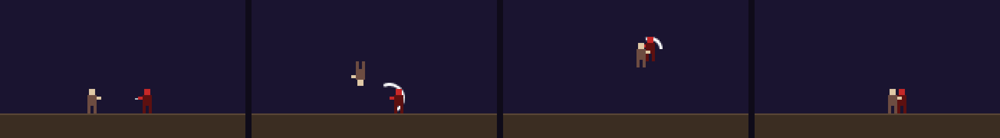
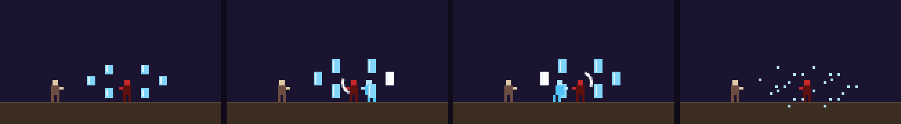
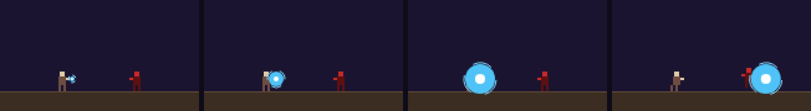
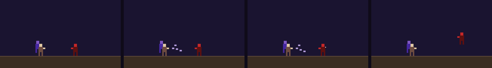
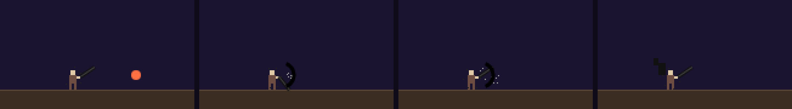
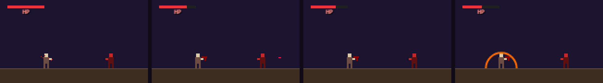
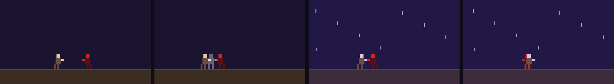
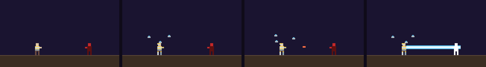
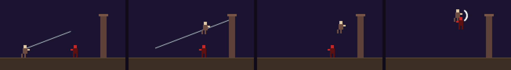
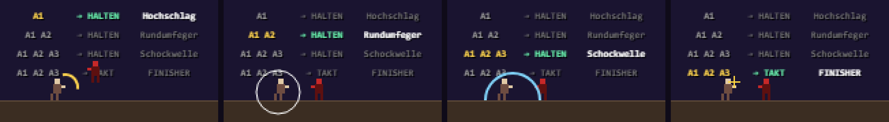

# GRIMGE – Fähigkeiten-Atlas II: Mehrfach-Runen, geführte Ketten, Kampfkunst, Rüstungen

Analyse vom 23.10.2026.

**Grundsatz:** Alles ist für GRIMGE **angepasst, nicht kopiert**. Namen, Formen und Farben sind eigene. Die Vorbilder liefern nur das *Gefühl* einer Technik, also Rhythmus, Wucht, Wiedererkennung.

**Die Bilder** stammen aus `public/concepts/ability_concepts.html`. Die Storyboards laufen dort animiert und sind unter `/concepts/ability_concepts.html` auf dem Dev-Server zu sehen. Die Figuren sind Platzhalter; mit den echten Sprites wird es entsprechend besser.

---

## 0. Kurzfazit: die stärksten nächsten Schritte

| # | Idee | Warum | Aufwand | baut auf |
| --- | --- | --- | --- | --- |
| 1 | **Geführte Ketten**, z. B. Schattenreigen (Kap. 3) | genau das „Ninja-Gefühl“: ein Spezialrunen-Treffer öffnet eine Kette aus Takten | M | Finisher-Takt, Air-Latch, SigSequence |
| 2 | **Kombo-Abzweigungen** (Kap. 9) | manuelle Tiefe: nach Angriff 1/2/3 ein *Halten* = eigene Technik | S–M | Kombo-Kette, Waffen-Kits |
| 3 | **Eisspiegel-Reigen** (Ausbau von S50 Spiegelkerker) | Hämmern = mehr Spiegel-Angriffe, gut lesbar | S | Recast „again“ |
| 4 | **Spiralkern** (Ausbau von S46 Spiralkugel) | Halten + Tippen lässt die Kugel wachsen | S | Recast, Halten |
| 5 | **Konstruktpanzer** als Arcane State (Kap. 7) | Rüstung mit Drohnen, starker Wunsch, passt zu Konstrukt | L | Arcane-State-System |
| 6 | **Nullklinge** (Anti-Magie) | einzigartige Konter-Identität: Zauber zerschneiden | M | Projektil-Erkennung (S20/S22) |
| 7 | **Blutfinsternis** (Oni-Blut) | HP als Munition, passt zu Opfer und Letztem Gefecht | M | Haltung, Waffen-Schüsse |
| 8 | **Zeitspalt** (perfektes Ausweichen) | Belohnung für Können, macht Ketten möglich | M | Backdash, Zeitlupe (S56) |

---

## 1. Was es schon gibt (damit nichts doppelt wird)

| Vorbild | schon in GRIMGE |
| --- | --- |
| Spiralkugel / Rasengan | **S46 Spiralkugel** (zweistufig, Launcher) |
| Eisspiegel-Gefängnis | **S50 Spiegelkerker** (mehrstufig) |
| Teleport-Kunai | **S45 Blitzmarke** |
| Kamehameha / großer Strahl | **S71 Zornstrahl** |
| Bankai | **A04 Bankai** (passt sich der Waffe an) |
| Domänen-Erweiterung | **Sphären S53–S69, S85** |
| Atemtechniken | **S40–S42, S75–S84** |
| Haki | **S86 Wille** |
| Zeitstopp | **S73 Zeitstopp** |
| Trugbilder / Doppelgänger | **S74 Trugbild**, Doppel |
| Teufelsvertrag | **S72 Blutvertrag** |
| Wut-Verwandlung + Riesenschlag | **S87 Edles Opfer** |

Neu sind deshalb vor allem: **geführte Ketten**, **Hämmern als Eingabe**, **Kombo-Abzweigungen**, **Anti-Magie**, **HP-Munition**, **Rüstung mit Drohnen**, **Zeitspalt**, **Seilmanöver**, **Schwur**, **Element-Fresser**, **Sammelkugel**.

---

## 2. Die Eingabe-Grammatik (Bausteine für Mehrfach-Runen)

Jede neue Rune setzt sich aus wenigen, *lernbaren* Bausteinen zusammen. So weiß der Spieler, was ihn erwartet.

| Baustein | Eingabe | Gefühl | Code-Basis |
| --- | --- | --- | --- |
| **Erneut tippen** | Slot ein 2./3. Mal | Stufen: Falle → Auslösen | `offerRecast` (gibt es) |
| **Hämmern** | schnell tippen, solange das Fenster offen ist | „ORA-ORA“: mehr Tipps = mehr Treffer | `again: true` + Zähler, Fenster 1,5–2,5 s |
| **Takt** | Tippen im richtigen Moment (Ring nur im Training) | Rhythmus, Können | Finisher-Fenster (gibt es) |
| **Halten / Loslassen** | Slot halten, loslassen | Aufladen in Stufen | `releaseOnUp` (gibt es) |
| **Richtungs-Wischen** | in der Kette in eine Richtung wischen | „von der Seite angreifen“ | Touch-Gesten (gibt es) |
| **Treffer-Bestätigung** | die Kette öffnet nur bei Treffer | fair, wie die Kombo | `hitConfirmed` |
| **Anker-Netz** | Punkte setzen, Tipp springt zum nächsten | Spiegel, Marken, Haken | Marken (S12, S45) |

**Regeln, damit es fair bleibt (vor allem PvP):**
- Eine Kette dauert höchstens etwa 2,5 s.
- Der Schaden pro Takt sinkt leicht mit der Länge der Kette (Abschwächung wie bei Kombos).
- Ein **perfekter Block** des Gegners bricht die Kette.
- Ein Gegner mit vollem **Fokus** kann einmal pro Match ausbrechen („Ausbruch“).
- Verpasste Takte beenden die Kette sofort und lassen keine lange Erholung zurück.

---

## 3. Kern-Neuheit: Geführte Ketten (Kampfkunst-Ketten)

**Prinzip:**
1. Eine Spezialrune trifft (z. B. ein Kunai). Damit öffnet sich eine **Kette**.
2. Jeder Takt ist eine vorgegebene, wuchtige Bewegung. Der Spieler bestätigt sie mit **Angriff** (Tippen) oder mit einem **Wischen in eine Richtung**, das die Angriffsrichtung wählt.
3. Getroffene Takte erhöhen den Schaden (z. B. bis ×1,6).
4. Ein verpasster Takt beendet die Kette.

Die Ketten **ergänzen** die manuelle Kombo und ersetzen sie nicht. Angriff 1–3, Finisher, Hochschlag und Luftkombos bleiben die Grundlage. Die Kette ist das „Spezial-Highlight“ und kostet Mana.

| Takt | Schattenreigen (Beispiel) | Eingabe |
| --- | --- | --- |
| 0 | Kunai trifft, die Kette öffnet sich | Rune |
| 1 | Rückwärtssalto mit Schnitt | Tipp |
| 2 | Ansturm | Tipp / Wischen vorwärts |
| 3 | Hochschlag (Launcher) | Tipp / Wischen hoch |
| 4–6 | Luftkombo, drei Treffer | Takt-Tippen |
| 7 | Erdhammer (Abschluss) | Wischen runter |

### Umgesetzt: S88 SCHATTENREIGEN (23.10.2026)

- **Rune:** Mehrfach-Kategorie, 34 Mana, eigene Glyphe (Kunai im Salto-Bogen). Ein Kunai fliegt etwa 290 px weit.
- **Kette:** Trifft der Kunai, öffnet sich die Kette (Fenster 0,8 s für den ersten Takt). Jeder weitere Takt hat ein Fenster von 0,55 s.
- **Eingaben:** Tippen geht immer. Wischen in Richtung des Takts geht auch (→ Ansturm, ↑ Hochschlag, ↓ Erdhammer).
- **Ablauf:** Salto-Schnitt → Ansturm → Hochschlag (beide steigen auf) → drei Luftschnitte → Erdhammer mit Druckwelle (trifft auch Gegner daneben).
- **Schaden:** Jeder bestätigte Takt erhöht ihn um +10 %, bis ×1,6. Eine volle Kette macht etwa 190 Schaden, dazu Flächenschaden.
- **Zeitpunkte:**
  - Ein später Druck in einem Takt wird gemerkt und startet den nächsten, es stockt nicht.
  - Wildes Drücken früh in einem Takt wird ignoriert.
  - Ein verpasstes Fenster beendet die Kette sofort.
- **Fairness:**
  - Der Held ist nur während der Takt-Bewegungen unverwundbar, in den Fenstern nicht.
  - Der Gegner wird beim Ende sofort losgelassen, die Kette dauert höchstens etwa 2,5 s.
  - Laden und HOLD sind während der Kette gesperrt; die Kette besitzt die Eingaben.
- **Hinweise:**
  - In jedem Modus blitzt die Waffe auf, wenn der nächste Takt bestätigt werden kann.
  - Nur im Training stehen Takt-Name und Eingabe („2/7 ANSTURM · TIPP / WISCH →“) über dem Kopf.
- **Technik:** `guided_chains.js` enthält eine allgemeine `GuidedChain`-Klasse; Ketten sind Daten (Takte mit start / tick / accept). Donnerkette und Klingenballett lassen sich damit schnell ergänzen.

**Weitere Ketten (je Klasse / Element):**

| Kette | Öffner | Takte | Besonderheit |
| --- | --- | --- | --- |
| **Schattenreigen** (Klingen, Ninja) | Kunai-Wurf | Salto-Schnitt → Ansturm → Hochschlag → Luft ×3 → Erdhammer | der Klassiker |
| **Donnerkette** (Fulgur) | Blitzmarke trifft | jeder Tipp ein Blitzschritt zum *nächsten* Gegner, am Ende ein Donnerschlag auf alle | Gruppen-Kette |
| **Drachenfaust-Folge** (Fäuste, Mönch) | Handflächenstoß | Hämmern: Faustserie → aufsteigender Drachenhaken → fallender Meteortritt | Hämmern in Takt 1 |
| **Klingenballett** (Doppelklingen) | Klingenwirbel trifft | jedes **Wischen** wählt die Seite: von hinten, von oben, von unten … | „aus allen Richtungen“ |
| **Bestienjagd** (Klauen, Bestia) | Ansprung | Krallen-Ansturm aus vier Richtungen mit Nachbildern, dann ein Biss mit Blutung | Nachbilder (S11) |
| **Speerwirbel** (Speer) | Stoß | Hebelstoß hoch → Stichsalve in der Luft → Pfählstoß nach unten | nutzt die Speer-Salve |
| **Hammerbeben** (schwere Waffen) | Erdbrecher | zwei Beben im Takt → Hammerwurf → Rückruf trifft im Rücken | Waffen-Rückruf |
| **Seilmanöver** (Fernkampf, Allrounder) | Haken trifft | heranziehen → Schwungtritt → Abstoßen in die Luft → Pfeilhagel von oben | siehe Kap. 8 |

---

## 4. Mehrfach-Runen-Katalog (Tippen · Hämmern · Halten)

| Rune | Vorbild-Gefühl | Eingabe | Mechanik | Optik (Pixel) |
| --- | --- | --- | --- | --- |
| **Eisspiegel-Reigen** (S50 ausbauen) | Eisspiegel-Technik | Hämmern bis 8× | Jeder Tipp: ein Spiegelbild springt aus einem der 6 Spiegel und schneidet. Der letzte Tipp lässt alle Spiegel zerspringen (Splitterschaden). | hellblaue Spiegel, weißer Kern, Splitter-Quadrate |
| **Spiralkern** (S46 ausbauen) | Spiralkugel | Halten + Tippen | Jedes Tippen lässt die Kugel eine Stufe wachsen (bis 5), Loslassen stößt sie bohrend durch die Gegner. Größer heißt langsamer und stärker. | blaue Kugel, kreisende Ringe, weißer Kern |
| **Wächtergeist-Hagel** | Schutzgeist hinter dem Kämpfer | Hämmern | Ein Geist erscheint hinter dir. Schnelles Tippen gibt einen Schlaghagel (bis 30 Treffer, schwach je Treffer), der Abschluss schleudert. | violetter Geist, Faust-Nachbilder |
| **Tausendstich** | Stichhagel | Hämmern | Speer- oder Klingen-Stichhagel nach vorn, Reichweite wächst mit dem Takt | Stichlinien, Funken |
| **Sternenregen** | markierte Punkte | Tippen setzt Marken, Halten löst aus | bis zu 5 Bodenmarken, dann fallen Sterne nacheinander | goldene Marken, fallende Sterne |
| **Sammelkugel** | große Energiekugel über dem Kopf | Halten (lang) | Verbündete und Minions in der Nähe speisen sie, je länger desto größer, Wurf zum Schluss | weiße Kugel, Energiefäden von Verbündeten |
| **Glyphen-Kaskade** | Runen-Stapel und Strahl (Arcanist-Gefühl) | normale Runen wirken → Stapel, dann Halten | Jede gewirkte Rune legt eine Glyphe an (max. 3). Halten entlädt einen Strahl, der mit den Glyphen länger und stärker wird. | Glyphen kreisen, Strahl in Runenfarbe |
| **Zündrune für Verbündete** | Gruppen-Zündung (ESO-Synergie) | Rune setzen | Eine Rune am Gegner; trifft ein **Verbündeter** sie, explodiert sie (Koop-Kombo). | pulsierende Rune |
| **Knochenkoloss** | Totenbeschwörer-Ultimate | Halten | ein Knochen-Golem für 10 s, Fäuste stampfen, mit Mortis kombinierbar | Knochenplatten, grünes Licht |
| **Schattenmantel** | Unsichtbarkeit (Nachtklinge) | einmal | 3 s unsichtbar, der erste Angriff daraus ist kritisch und lähmt | Umriss flackert |
| **Blutstrom-Klinge** | verwobene Blutschnitte | Hämmern, kostet HP | Jeder Tipp ein weiterer verwobener Blutschnitt nach vorn, Blutung wird aufgebaut. HP-Kosten pro Schnitt. | dunkelrote Sicheln |
| **Jagdschritt** | unsichtbarer Ausweichsprung | einmal | kurzer Sprung mit Unverwundbarkeit, du verschwindest dabei | Nachbild-Linien |
| **Löwensprung** | Vorwärtssalto mit Axthieb | einmal | Salto nach vorn, wuchtiger Schlag, durchbricht Abwehr | Bogen-Spur, Boden-Riss |
| **Mondschleier-Iai** | magische Ziehwelle | Halten | Klinge in der Scheide laden, Ziehen schickt eine blaue Mondwelle | blaue Sichel |
| **Eislanze** | geladener Eisspeer | Halten | Speer aus Eis laden, Stoß nach vorn, gefriert im Weg | Kristallspitze, Frostspur |

---

## 5. Anime-Adaptionen (angepasst)

### Oni-Blut (nach Tougen Anki) → **Blutfinsternis**
Im Original formt der Held aus seinem eigenen Blut Waffen, vor allem Schusswaffen. Sein Erbe ist das Feuer.

**In GRIMGE als Haltung (15 s):**
- HP werden zu Munition: Jeder Schuss kostet 2 HP.
- Die Blutwaffe nimmt die Form deiner Klasse an: Blutpistolen ohne Waffe, ein Blutbogen beim Bogen, Blutklingen bei Klingen.
- Je weniger HP, desto stärker die Schüsse. Das passt zu Letztes Gefecht und Umbra · Opfer.
- Aufladen hoch, **Erwachen:** eine Feuerwelle, umso stärker, je weniger HP du hast.
- Aufladen runter, **Blutstillung:** HP zurück für jede Blutung an Gegnern.

**Empfehlung:** als Haltung, nicht als Arcane State. Der Arcane-State-Platz ist kostbar, und diese Rune lebt vom Spiel mit den HP.

### Black Clover → **Nullklinge** und **Teufelsunion**
- **Nullklinge** (Haltung oder Waffen-Spezial): Ein schwarzes Schwert mit dunkler Aura.
  - Jeder Schnitt **löscht Projektile und gegnerische Zauber** im Bogen. Strahlen werden zurückgeworfen.
  - Gegnerische Haltungen im Bogen enden.
  - Konter-Identität: perfekt gegen Zauberer.
- **Teufelsunion** (Arcane State): ein schwarzer Flügel und Hörner. Die Anti-Magie-Schnitte werden zu weiten Halbmonden, Flügelschläge stoßen weg.
- **Grimoire-Haltung:** Dein Runen-Deck wird zum offenen Grimoire. Die nächsten 3 gewirkten Runen hallen einmal nach (halbe Stärke).

### Weitere Anime-Gefühle

| Gefühl | GRIMGE-Idee | Kurz |
| --- | --- | --- |
| Schutzgeist mit Schlaghagel | **Wächtergeist-Hagel** | Hämmern-Rune, siehe Kap. 4 |
| Schwur / Bindung (Nen-Gefühl) | **Schwur** | Du wählst eine Einschränkung (10 s keine Runen) und bekommst dafür Kraft (+60 % Nahkampf). Bricht man den Schwur, gibt es einen Schadensrückschlag. |
| Prozent-Kraft mit Überlast | **Überlast** | Aufladen über 100 %: stärker, aber Selbstschaden |
| Schatten-Armee | **Schattenernte** (Mortis ausbauen) | Besiegte Gegner erheben sich kurz als Schatten |
| 3D-Manöver-Ausrüstung | **Seilmanöver** | Haken und Schwung, siehe Kap. 8 |
| Element fressen | **Element-Fresser** | einen gegnerischen Zauber im Block „fressen“ und dann 8 s dieses Element auf den Angriffen |
| Große Energiekugel | **Sammelkugel** | siehe Kap. 4 |
| Feuer-Antrieb | **Flammenantrieb** | Sprint und Sprünge mit Feuerstoß, Ansturm hinterlässt eine Brandspur |

---

## 6. Spiele-Adaptionen

| Spiel-Gefühl | Was wir übernehmen (angepasst) | GRIMGE-Umsetzung |
| --- | --- | --- |
| **Elden Ring**: Kriegsaschen | Waffen-Fertigkeiten als eigener, austauschbarer Slot | Die Waffen-Kits (Aufladen runter) werden zu **Waffenkünsten**: pro Waffe 2–3 zur Wahl, freispielbar. Beispiele: Jagdschritt, Löwensprung, Mondschleier-Iai, Blutstrom-Klinge. |
| **Elder Scrolls Online**: Klassenlinien, Synergien, Ultimates | Klassen-Identität, Koop-Zündungen | Klassen-Passive je Familie. **Synergien:** Ein Verbündeter löst deine Rune aus, z. B. die Zündrune. Glyphen-Stapel nach dem Arcanist-Gefühl. |
| **Dynasty Warriors**: Charge-Abzweigungen, Musou, Haltung brechen | manuelle Tiefe und Massen-Gefühl | **Kombo-Abzweigungen** (Kap. 9). **Musou-Ansturm** als zweite Fokus-Option neben der Transformation. **Haltungsbruch:** Treffer auf Schwachstellen füllen eine Leiste, gebrochen gibt es einen „Sturm“-Finisher. |
| **Sekiro**: Haltung und Todesstoß | Konter statt Lebensbalken | Ein **Haltungsbalken** für Bosse; gebrochen folgt eine **Hinrichtung** (Kurz-Ketten-Animation). |
| **Devil May Cry**: Stil-Rang | Abwechslung belohnen | **Stil-Rang** C → SSS: Abwechslung aus Kombo, Rune, Kette und Luft füllt ihn und gibt Fokus und XP. |
| **Bayonetta**-Gefühl: Ausweichen verlangsamt | Können belohnen | **Zeitspalt** (siehe unten) |
| **God of War**: Axt-Rückruf | Wurf und Rückruf | Geworfene Waffe kommt auf Tipp zurück und trifft dabei auch von hinten |
| **Ghost of Tsushima**: Haltungen | Waffen-Haltung wechseln | Atmungen und Haltungen sind das schon; möglich wären Klassen-Haltungen (Stein / Wasser / Wind) |

**Zeitspalt:**
- Ein Ausweichen (Backdash) im letzten Moment vor einem Treffer öffnet 2 s „Zeitspalt“: Die Welt wird langsamer, nur du nicht.
- **In PvP** verlangsamt nur der angreifende Gegner, nicht die ganze Welt. Das hält es fair und mehrspielertauglich (keine globale Zeitlupe).

---

## 7. Rüstung mit Drohnen (Iron-Man-Gefühl): Klasse oder Arcane State?

| Kriterium | als **Arcane State** | als **Klassen-Transformation** |
| --- | --- | --- |
| Wer kann es nutzen | jede Klasse (Rune im Deck) | nur eine Klasse |
| Freischalten | Boss-Drop oder Konstrukt-Rune Lv. 8 | Klassenwaffe Lv. X |
| Passt zum Thema | Konstrukt-Element: Platten, Schmiede, Klingen | eine „Runenschmied“-Klasse |
| Deck-Kosten | belegt den einzigen Arcane-State-Platz | kein Deck-Platz |
| Wiedererkennung | hoch: „der Panzer“ | sehr hoch, aber nur für eine Klasse |

**Empfehlung:** **beides, gestuft.**
1. **Konstruktpanzer als Arcane State (A05)**, freigeschaltet über Konstrukt Lv. 8 oder einen Boss-Drop.
2. Später kommt eine **Klasse „Runenschmied“** (Klassenwaffe: Handschuh-Werfer). Sie bringt eine eigene kleine Drohne mit, und mit dem Konstruktpanzer bekommt sie +1 Drohne und schnellere Platten.

So ist die Rüstung für alle da, und die Klasse hat ihren Mehrwert.

**Konstruktpanzer – Moveset (im Arcane-State-Schema):**

| Eingabe | Kurz | Voll |
| --- | --- | --- |
| Aufladen → | Handflächen-Salve (3 Schüsse) | **Kernstrahl** aus der Brust (langer Strahl) |
| Aufladen ↑ | Schubstoß nach oben | Raketen-Fächer auf markierte Gegner |
| Aufladen ↓ | Drohnen-Wall vor dir | Drohnen-Netz: alle Projektile in 3 s abfangen |
| Halten | **Zielaufschaltung**: die Drohnen markieren bis zu 3 Gegner | – |
| Luft ↓ | Schubsturz mit Aufprallwelle | – |
| passiv | 3 Drohnen kreisen; alle 3 s fängt eine ein Projektil ab | – |

**Optik:**
- Die Platten setzen sich Stück für Stück an den Sprite. Ein goldener Rand läuft entlang der Plattenkanten.
- Die Drohnen sind kleine graue Rauten mit blauem Auge.
- Strahlen sind hellblau mit weißem Kern; harte Pixel, kein weiches Leuchten.

---

## 8. Kampfkunst und Mischformen (nicht nur Magie)

| Technik | Wirkung | Eingabe |
| --- | --- | --- |
| **Wurf / Griff** | Nahkampf-Griff, dann Wurf in Wischrichtung | nah am Gegner: Halten + Wischen |
| **Wandabpraller** | Gegner prallt von Mauer und Turm ab und ist kurz wieder treffbar | starker Treffer Richtung Wand |
| **Bodenabpraller** | Erdhammer lässt den Gegner hochspringen (Jonglieren) | Luft ↓ auf einen Gegner in der Luft |
| **Runen-Abbruch** | einen Angriff mitten im Schwung in eine Spezialrune abbrechen (kostet etwas Ausdauer) | Rune während des Angriffs |
| **Ausweichangriff** | Angriff direkt aus dem Backdash (gibt es als Konterschuss) | Angriff im Backdash |
| **Seilmanöver** | Haken an Gegner oder Turm, heranziehen, Schwungtritt, Abstoßen in die Luft | Rune, dann Tipp, dann Tipp |
| **Konter-Haltung** | kurzes Fenster: Treffer wird mit Gegenschlag beantwortet (gibt es bei Schild-Waffen) | Aufladen ↓ |
| **Sprint-Gleiten** | Rutschen unter Projektilen durch, mit Tritt | Sprint + ↓ |

---

## 9. Kombo-Abzweigungen (manuell, ergänzend) – umgesetzt am 23.10.2026

Die Abzweige laufen über die **Wisch-Gesten, die es schon gibt**, je nach Kombo-Schritt. Die Skizze zeigt noch die erste Idee mit „Halten“; die wurde verworfen, weil Halten schon für Aufladen und die HOLD-Fähigkeit steht.

| Folge | Geste | Ergebnis |
| --- | --- | --- |
| A1 (oder A2 / A3) → | **Wischen hoch** | **Hochschlag-Abzweig**: Der Gegner fliegt höher als beim normalen Hochschlag, der Held bleibt unten und kann nachsetzen. |
| A1 A2 → | **Wischen vorwärts** | **Rundumfeger**: ein weiter Schwung rundherum, trifft auch hinten. |
| A1 A2 A3 → | **Wischen vorwärts** | **Schockwelle** der Waffe (Fernwaffen: eine Salve). |
| A1 A2 A3 → | **Tippen im Takt** | **Finisher** (wie bisher) |
| aus dem Stand | Wischen | normaler schwerer Angriff (wie bisher) |

**Nachsetzen nach dem Hochschlag-Abzweig:**
- Trifft der Hochschlag, öffnet sich ein kurzes Fenster (0,45 s), in dem der Held geduckt sprungbereit steht.
- **Tippen** im Fenster: Er springt dem Gegner hinterher und schlägt sofort zu. Weiteres Tippen setzt die Luftkombo fort.
- **Springen** geht auch von Hand.
- **Ohne Tipp** passiert nichts von selbst; man muss sich aktiv entscheiden.
- **Grenzen gegen Einseitigkeit:** Der Abzweig kommt einmal pro Kette, in der Luft gibt es höchstens 3 Treffer pro Sprung (Luft-Latch). Danach fällt der Gegner.

Halten bleibt unverändert für Aufladen (Halten + Ziehen) und die HOLD-Fähigkeit (Halten ohne Ziehen). So hat keine Geste zwei Bedeutungen.

## 10. Reihenfolge-Vorschlag

1. **Kombo-Abzweigungen:** kleiner Schritt, viel Tiefe für jede Waffe.
2. **Geführte Kette: Schattenreigen** als Prototyp des Ketten-Systems (Takt, Wischen, Abbruch-Regeln). Danach Donnerkette und Klingenballett.
3. **Hämmern als Baustein:** Eisspiegel-Reigen und Spiralkern-Ausbau, danach Wächtergeist-Hagel.
4. **Nullklinge** und **Zeitspalt** für Konter-Tiefe.
5. **Blutfinsternis** als Haltung.
6. **Konstruktpanzer** als Arcane State (A05).
7. Später: Klasse **Runenschmied**, **Stil-Rang**, **Haltungsbalken und Hinrichtung** für Bosse, **Synergien** im Koop.

Sag mir, womit ich anfangen soll. Ich würde mit 1 und 2 beginnen: Danach fühlt sich der Nahkampf am stärksten anders an.

---

## Quellen (Recherche 23.10.2026)

- Tougen Anki – Überblick und Blutwaffen: [Wikipedia](https://en.wikipedia.org/wiki/Tougen_Anki), [Timeline](https://shapes.inc/fandom/tougen-anki/timeline), [Sportskeeda, Folge 1](https://www.sportskeeda.com/anime/tougen-anki-episode-1-shiki-s-demon-powers-awaken-learns-truth-origins)
- Black Clover – Grimoires und Anti-Magie: [Deltia's Gaming](https://deltiasgaming.com/?p=99002), [Sportskeeda](https://www.sportskeeda.com/anime/9-unique-grimoires-black-clover)
- Dynasty Warriors: Origins – Kampfsystem: [Deltia's Gaming, Einsteiger-Guide](https://deltiasgaming.com/?p=116140), [Slant Review](https://slantmagazine.com/games/dynasty-warriors-origins-review)
- Elder Scrolls Online – Klassen und Fertigkeitslinien: [UESP](https://en.m.uesp.net/wiki/ESO:Classes), [Hack the Minotaur](https://hacktheminotaur.com/eso-guides/best-healer-class/)
- Elden Ring – Kriegsaschen: [PC Gamer](https://pcgamer.com/best-elden-ring-ashes-of-war), [GamesRadar Patch 1.06](https://www.gamesradar.com/elden-ring-patch-106)
