# GRIMGE — Runen- & Spell-Katalog (Stand Web-Prototyp)

> Automatisch aus den Spieldaten erzeugt (`public/src/recognizer.js`, `rune_guides.js`, `spell_catalog.js`). Glyphen-Bilder: `docs/runes/*.svg` (Startpunkt = nummerierter weißer Punkt, Strichreihenfolge = Nummer).
> Zweck: Grundlage für einen Research-Agenten, der weitere Spells entwerfen bzw. aus anderen Spielen/Animes recherchieren soll (siehe Abschnitt 8).

## Inhalt
1. [Grundsystem](#1-grundsystem) · 2. [Runen](#2-runen) · 3. [Spells](#3-spells) · 4. [Kombinationsmatrix](#4-kombinationsmatrix) · 5. [Transformationen & Form-Techniken](#5-transformationen--form-techniken) · 6. [Glossar](#6-glossar-delivery-zielmodi-tags) · 7. [Statistik](#7-statistik) · 8. [Hinweise für den Research-Agenten](#8-hinweise-für-den-research-agenten)

## 1. Grundsystem

- **Runen zeichnen:** Der Spieler zeichnet eine Rune aus seiner Hand (Deck aus 10 Karten, Hand = 3, verbrauchte Runen gehen ans Deckende). Der Erkenner bewertet die Zeichnung mit einer **Qualität C/B/A/S**.
- **Mana** wird beim Zeichnen **gebunden** (nicht beim Wirken). Fusionierte Spells kosten die Summe ihrer Runen.
- **3 Spell-Slots:** Jede gezeichnete Rune liegt als fertiger 1-Runen-Spell in einem Slot (Tasten Z/X/C, Gamepad LB/RB/RT, Touch: Slot antippen).
- **Fusion:** Zwei oder drei Slots gleichzeitig halten (bzw. von Slot zu Slot wischen) → Rezept-Lookup (reihenfolgeunabhängig, Schlüssel = sortierte Rune-IDs). Gibt es kein Rezept, bleibt im Match nur **ein zufälliger** der Slots übrig (Training: nichts geht verloren). Fusionierte Spells und Spezial-Runen können **nicht erneut** fusioniert werden.
- **Solo-Spezialrunen** (`doppel`, `mortis`): schwere Glyphe, sind allein ein vollständiger Spell, nie fusionierbar.
- **Transformations-Runen** (`transform_*`): Altbestand — werden nicht mehr vergeben. ANNIHILATION BEAM kommt als Form-Technik (Focus Ascendant, Heavy-Charge vorwärts voll); VOID IMPLOSION (Bestia+Terra+Void) und INFERNO RAMPAGE (Bestia+Ignis+Void) sind jetzt 3-Runen-Kombinationen.
- **Castle Siege:** Runen werden nur auf der eigenen Burg-Plattform gezeichnet; geslottete Spells wirken überall.

**Qualitätsstufen** (`RUNE_GRADE_PROFILES`):

| Grade | Power | Area | Duration | Partikel |
|---|---|---|---|---|
| C | ×0.80 | ×0.86 | ×0.84 | ×0.78 |
| B | ×1.00 | ×1.00 | ×1.00 | ×1.00 |
| A | ×1.10 | ×1.08 | ×1.08 | ×1.15 |
| S | ×1.25 | ×1.20 | ×1.20 | ×1.40 |

## 2. Runen

| Glyphe | Rune | Element | Icon | Farbe | Mana | Zeichnen | Allein ergibt |
|---|---|---|---|---|---|---|---|
|  | **IGNIS** `ignis` | Fire | 🔥 | `#ff4b1f` | 10 | Upward Triangle or Chevron | IGNIS FIREBALL |
|  | **VENTUS** `ventus` | Wind | 💨 | `#00d2ff` | 10 | Horizontal Slash / Dash | GALE SHOCKWAVE |
|  | **FULGUR** `fulgur` | Lightning | ⚡ | `#ffd000` | 12 | Zig-Zag Shape (Z) | ARC LIGHTNING |
|  | **TERRA** `terra` | Earth | 🪨 | `#43a047` | 10 | Square / U-Box | STONE SPIKES |
|  | **AQUA** `aqua` | Frost | ❄️ | `#00e5ff` | 10 | Circular Glyph | FROST NOVA |
|  | **BESTIA** `bestia` | Beast | 🐺 | `#b388ff` | 18 | Three-Peak Claw / M | BEAST FAMILIAR |
|  | **KONSTRUKT** `construct` | Construct | ⚙️ | `#b0bec5` | 16 | Tall Pillar / Tower Stroke | CONSTRUCT BULWARK |
|  | **VOID** `void` | Void | 🕳️ | `#8e24aa` | 16 | Open Spiral / Void Eye | VOID BOLT |
|  | **LUX** `lux` | Light | ☀ | `#ffe082` | 12 | Star: four crossing lines (+ then ×) | HALO PULSE |
|  | **NATURA** `natura` | Nature | 🌿 | `#7ddc5a` | 12 | Leaf: a closed leaf outline, then its midrib | HEILBLÜTE |
|  | **UMBRA** `umbra` | Shadow | ☾ | `#7e57c2` | 12 | Open crescent arc (C shape) | SHADOW STEP |
|  | **DOPPEL** `doppel` | Shadow | ♊ | `#5e35b1` | 22 | Special: one closed figure-eight (∞) — your shadow double | SHADOW DOPPELGANGER |
|  | **MORTIS** `mortis` | Death | ☠ | `#9ccc65` | 26 | Special: a five-pointed star in one stroke — raise the fallen | REVENANT CALL |
| ★ | **ANNIHILATION BEAM** `transform_beam` | Transformation | ★ | `#ff4cff` | 0 | Any gesture while Focus Ascendant | ANNIHILATION BEAM |
| ◉ | **VOID IMPLOSION** `transform_implode` | Transformation | ◉ | `#b668ff` | 0 | Any gesture while Eidolon Mantle | — |
| ⚡ | **INFERNO RAMPAGE** `transform_rampage` | Transformation | ⚡ | `#ff6f3b` | 0 | Any gesture while Ninefold Beast | — |
|  | **ARCANE-STATE-SIEGEL** `buff_*` (17 Runen) | Arcane State | ⧗ | je Form | 30 | Sanduhr ⧗ in einem geschlossenen Strich — **Tag: arcane-state · max-1-per-deck** | der Arcane State der Rune (Abschnitt 3.7) |
| 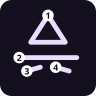 | **SIGNATURE-SPEZIALRUNEN** `sig_*` (48 Runen) | Signature Special | ✦ | je Rune | 28–44 | **eigenes mehrstrichiges Symbol je Rune** (Abschnitt 3.8) — Tag: signature-special · je Rune 1× pro Deck | die Signature-Mechanik der Rune (Abschnitt 3.8) |

### Glyphen als ASCII (Ziffer = Startpunkt des Strichs)

**⧗ ARCANE-STATE-SIEGEL** — Sanduhr in einem geschlossenen Strich (gilt für alle Arcane-State-Runen)
```

   1##########
     ##   ##
      ## ##
       ###
      ## ##
     ##   ##
   ###########

```
**🔥 IGNIS** — Upward Triangle or Chevron
```

       ###
      ## ##
     ##   ##
    ##     ##
   ##       ##
  ##         ##
  1############

```
**💨 VENTUS** — Horizontal Slash / Dash
```


1################


```
**⚡ FULGUR** — Zig-Zag Shape (Z)
```

  1############
           ###
         ###
       ###
     ###
   ###
  #############

```
**🪨 TERRA** — Square / U-Box
```

  1############
  #           #
  #           #
  #           #
  #           #
  #           #
  #############

```
**❄️ AQUA** — Circular Glyph
```

    ####1####
  ###       ###
  #           #
  #           #
  #           #
  ###       ###
    #########

```
**🐺 BESTIA** — Three-Peak Claw / M
```

        #
   ##  ###  ##
  ###  # #  ###
  # #### #### #
 ##  ##   ##  ##
 #   ##   ##   #
 1             #

```
**⚙️ KONSTRUKT** — Tall Pillar / Tower Stroke
```
        1
        #
        #
        #
        #
        #
        #
        #
        #
```
**🕳️ VOID** — Open Spiral / Void Eye
```


      ######
     ##    ###
 #   #   1   #
 ##   ####   #
  ###      ##
    ########

```
**☀ LUX** — Star: four crossing lines (+ then ×)
```
        2
   3    #    4
   ###  #  ###
     #######
 1##############
     #######
   ###  #  ###
   #    #    #
        #
```
**🌿 NATURA** — Leaf: a closed leaf outline, then its midrib
```

      #####
     ## # ##
    ##  #  ##
    #   #   #
    ##  #  ##
     ## # ##
       #1#
        2
```
**☾ UMBRA** — Open crescent arc (C shape)
```

    #########
   ##
  #
  #
  #
   ##
    ########1

```
**♊ DOPPEL** — Special: one closed figure-eight (∞) — your shadow double
```


 ####       ####
 #  #### ####  #
#      #1#      #
 #  #### ####  #
 ####       ####


```
**☠ MORTIS** — Special: a five-pointed star in one stroke — raise the fallen
```

        1
       # #
  #############
   ####   ####
     #######
    #### ####
    ##     ##

```

## 3. Spells

### Übersicht

| Spell | Rezept | Delivery | Zielmodus | Kurzbeschreibung |
|---|---|---|---|---|
| **IGNIS FIREBALL** | 🔥 IGNIS | `projectile` | `direction` | Explosive projectile burning enemies. |
| **GALE SHOCKWAVE** | 💨 VENTUS | `area` | `direction` | High-velocity wind wave knocking enemies back. |
| **ARC LIGHTNING** | ⚡ FULGUR | `area` | `direction` | Crackling bolt leaping between targets. |
| **STONE SPIKES** | 🪨 TERRA | `area` | `direction` | Erupts jagged stone spikes from the ground. |
| **FROST NOVA** | ❄️ AQUA | `area` | `self` | Freezes surrounding foes solid. |
| **BEAST FAMILIAR** | 🐺 BESTIA | `summon` | `direction` | Summons a short-lived hunter familiar. |
| **CONSTRUCT BULWARK** | ⚙️ KONSTRUKT | `wall` | `placement` | Raises a short physical barrier in front of the caster. |
| **VOID BOLT** | 🕳️ VOID | `projectile` | `direction` | Fires a void projectile that slows the first target hit. |
| **HALO PULSE** | ☀ LUX | `area` | `self` | A ring of sunlight: heals you and nearby allies, sears and dazzles nearby enemies. |
| **SHADOW STEP** | ☾ UMBRA | `dash` | `direction` | Sink into your shadow and rise behind the nearest enemy ahead and strike it from its shadow. |
| **HEILBLÜTE** | 🌿 NATURA | `self` | `self` | A magic circle of blossoms at your feet heals you and nearby allies over 3 s and washes slows away. |
| **SHADOW DOPPELGANGER** | ♊ DOPPEL | `summon` | `self` | Your shadow rises as a weaker double with its own health and fights beside you. Casting again replaces the oldest double (Shadow passives keep more at once). |
| **REVENANT CALL** | ☠ MORTIS | `summon` | `self` | A forbidden seal raises the nearest fallen fighter as a bound revenant; when its borrowed body breaks it bursts. Casting again replaces the oldest revenant. |
| **STORM WOLF** | 🐺 BESTIA + ⚡ FULGUR | `summon` | `direction` | A lightning Hunter that bypasses the minion line to chase the Wizard. |
| **VOID SPIDER** | 🐺 BESTIA + 🕳️ VOID | `summon` | `direction` | A Control summon that entangles nearby enemies in slowing void webs. |
| **RUNE GOLEM** | ⚙️ KONSTRUKT + 🪨 TERRA | `summon` | `direction` | A durable Vanguard that binds defenders and marches on objectives. |
| **FIRESTORM VORTEX** | 🔥 IGNIS + 💨 VENTUS | `zone` | `ground` | Raging flame tornado that pulls enemies in, burns, and launches them! |
| **METEOR CATACLYSM** | ⚡ FULGUR + 🔥 IGNIS | `heavy_object` | `ground` | Calls down a blazing meteor that creates an explosive magma crater! A strong beam can shatter it mid-fall. |
| **TEMPEST BLITZ** | ⚡ FULGUR + 💨 VENTUS | `dash` | `direction` | Transforms into lightning, dashing forward and slashing all enemies! |
| **MAGMA FISSURE** | 🔥 IGNIS + 🪨 TERRA | `zone` | `ground` | Ruptures the earth with geysers of molten lava! |
| **SANDSTORM BASTION** | 🪨 TERRA + 💨 VENTUS | `self` | `self` | Swirling wall of stone and wind deflecting enemy attacks. |
| **BLIZZARD SURGE** | ❄️ AQUA + 💨 VENTUS | `zone` | `direction` | Freezing gale freezing minions and drastically slowing enemy lane push. |
| **AURA SHOCK** | ❄️ AQUA + ⚡ FULGUR | `area` | `self` | Frost-lightning pulse blasting surrounding enemies away. |
| **ARCANE AEGIS** | ❄️ AQUA + 🪨 TERRA | `self` | `ally` | A temporary protective aura that absorbs incoming damage. |
| **STONE WALL** | 🪨 TERRA + 🪨 TERRA | `wall` | `placement` | Raises a temporary earth wall that stops hostile movement and projectiles. |
| **INFERNO BEAM** | 🔥 IGNIS + 🔥 IGNIS | `beam` | `direction` | A sustained straight fire beam. Meets an enemy beam tip-to-tip for a Beam Clash. |
| **GLACIAL RAY** | ❄️ AQUA + ❄️ AQUA | `beam` | `direction` | A freezing ray that slows everything it touches. Clashable. |
| **THUNDER LANCE** | ⚡ FULGUR + ⚡ FULGUR | `beam` | `direction` | A very fast, short-lived lightning beam. Clashable. |
| **NULL RAY** | 🕳️ VOID + 🕳️ VOID | `beam` | `direction` | A void beam that drags its targets toward the caster. Clashable. |
| **MIRROR WARD** | ⚙️ KONSTRUKT + 💨 VENTUS | `capture` | `self` | A ward that captures up to five hostile projectiles, then fires them back as a volley. |
| **GRAVITY LIFT** | 💨 VENTUS + 🕳️ VOID | `telekinesis` | `ground` | Telekinesis: lifts up to four nearby enemies, holds them in the air, then slams them down. |
| **SEISMIC SLAM** | ⚡ FULGUR + 🪨 TERRA | `slam` | `direction` | A travelling ground shockwave that launches enemies and leaves short-lived rock pillars. |
| **TITAN STOMP** | 🐺 BESTIA + 🪨 TERRA | `stomp` | `direction` | Leap up and crash down: hits grounded and airborne enemies around the landing point. |
| **DRAGON BREATH** | 🐺 BESTIA + 🔥 IGNIS | `cone` | `direction` | A wide cone of chunky flame that widens with distance and burns everything inside. |
| **BURROW STRIKE** | 🪨 TERRA + 🕳️ VOID | `burrow` | `self` | Dig underground: untouchable and fast for a moment, then erupt and launch everything around you. |
| **SHADOW STOMPER** | 🪨 TERRA + ☾ UMBRA | `stomp` | `aim` | Aim, then stomp: your shadow races to the nearest enemy in that cone and holds its shadow — the target cannot move. Guarding targets slip free. |
| **RADIANT LANCE** | ☀ LUX + ☀ LUX | `beam` | `direction` | A blinding beam of light that dazzles what it touches. Clashable. |
| **FROST MIRROR GATE** | ❄️ AQUA + 🕳️ VOID | `zone` | `dual` | Set two points: an ice mirror rises at each. Step into one to come out of the other — an escape route back to the entrance of a long Dungeon room, or a sudden flank. |
| **SOUL SEEKERS** | 🔥 IGNIS + 🕳️ VOID | `homing` | `direction` | A salvo of three homing void flames that steer toward enemies within a turn limit. |
| **GROSSE BLÜTE** | 🌿 NATURA + 🌿 NATURA | `self` | `self` | A wide blossom circle: strong healing over 4 s and a light shield for every ally inside. |
| **HEILQUELLE** | ❄️ AQUA + 🌿 NATURA | `zone` | `self` | A spring wells up: allies standing in it heal and regain mana for 6 s. |
| **SEGENSKREIS** | ☀ LUX + 🌿 NATURA | `self` | `self` | A golden circle: allies inside heal at once and take 25 % less damage for 5 s. |
| **DORNENWUCHS** | 🌿 NATURA + 🪨 TERRA | `area` | `direction` | Brambles burst out along the ground ahead: they root whoever they catch and stay as a thorny hazard for 6 s. |
| **GIFTSUMPF** | 🌿 NATURA + ☾ UMBRA | `zone` | `ground` | A poisonous swamp at the target point slows and poisons foes for 7 s. |
| **POLLENSTURM** | 🌿 NATURA + 💨 VENTUS | `cone` | `direction` | A cone of drifting spores puts foes to sleep for a moment and slows them. |
| **FLAMMENSAMEN** | 🔥 IGNIS + 🌿 NATURA | `area` | `direction` | Four seeds are planted ahead; after a moment each bursts into fire and scorches the ground. |
| **FLAMMENKLINGE** | ⚙️ KONSTRUKT + 🔥 IGNIS | `self` | `self` | Your weapon (or fists) burns for 12 s: melee hits set foes on fire. |
| **FROSTKLINGE** | ❄️ AQUA + ⚙️ KONSTRUKT | `self` | `self` | Frost weapon for 12 s: hits slow, every third hit freezes. |
| **STURMKLINGE** | ⚙️ KONSTRUKT + ⚡ FULGUR | `self` | `self` | Storm weapon for 12 s: hits shock and a spark jumps to a second foe. |
| **GIFTKLINGE** | ⚙️ KONSTRUKT + 🌿 NATURA | `self` | `self` | Venom weapon for 12 s: hits poison foes for 4 s. |
| **BLUTKLINGE** | ⚙️ KONSTRUKT + ☾ UMBRA | `self` | `self` | Blood weapon for 12 s: every melee hit heals you for a fifth of its damage. |
| **REISSKLINGE** | 🐺 BESTIA + ⚙️ KONSTRUKT | `self` | `self` | Rending weapon for 12 s: hits make foes bleed for 3 s. |
| **SOLAR ORB** | 🔥 IGNIS + ☀ LUX | `self` | `self` | Summons a sun: bright light, short shadows. Fire and light grow stronger, ice melts fast, shadow magic weakens. |
| **LUNAR ORB** | ❄️ AQUA + ☾ UMBRA | `self` | `self` | Summons a moon: long shadows and a rising tide. Water, ice and shadow grow stronger, puddles slow and conduct harder, fire weakens. |
| **ECLIPSE** | ☀ LUX + ☾ UMBRA | `self` | `self` | Sun and moon meet: light and shadow magic surge, every other element dims, shadows grow huge. |
| **THUNDERHEAD** | ⚡ FULGUR + ☾ UMBRA | `self` | `self` | A black storm cloud strikes your enemies and their puddles with lightning. Fire burns out quickly. |
| **BLOOD MOON** | 🔥 IGNIS + ☾ UMBRA | `self` | `self` | A red moon: all spells hit harder, healing is halved, shadows turn red. Your doubles and revenants grow savage. |
| **STARFALL** | ☀ LUX + 💨 VENTUS | `self` | `self` | A night sky of falling stars that rain down on your enemies. |
| **AURORA VEIL** | ❄️ AQUA + ☀ LUX | `self` | `self` | Northern lights: your side slowly regenerates health and mana, ice grows stronger. |
| **VOID IMPLOSION** | 🐺 BESTIA + 🪨 TERRA + 🕳️ VOID | `zone` | `ground` | Creates a void singularity that pulls enemies in and crushes them with dimensional collapse. |
| **INFERNO RAMPAGE** | 🐺 BESTIA + 🔥 IGNIS + 🕳️ VOID | `dash` | `direction` | Blazing fire dash that scorches everything in its path across the lane. |
| **WELTENBAUM** | ❄️ AQUA + 🌿 NATURA + 🪨 TERRA | `zone` | `ground` | A giant tree grows and stays until it is cut down (or 25 s): it heals allies around it, swallows hostile projectiles, and its branches are platforms to stand on. |
| **ARKENGESTELL** |  | `self` | `self` | An open arcane force frame around the Wizard: damage resistance, knockback resistance and empowered melee. |
| **RISSWILD** |  | `self` | `self` | Three cracked molten energy bands: faster movement, savage melee and light damage resistance. |
| **DRAGON INVOCATION** | 🐺 BESTIA + 🔥 IGNIS + 💨 VENTUS / ⚡ FULGUR + 🔥 IGNIS + 🪨 TERRA | `area` | `direction` | Calls a temporary fire dragon to scorch a battlefield zone. |
| **WORLD RUNE SERPENT** | 🐺 BESTIA + 🪨 TERRA + 💨 VENTUS | `summon` | `direction` | A mountable lane-control serpent that slithers through the fight and launches enemies upward. |
| **SPIRIT WOLF** | ❄️ AQUA + 🪨 TERRA + 💨 VENTUS | `summon` | `direction` | Summons a quick frost spirit that hunts nearby enemies. |
| **SIEGE GOLEM** | ⚡ FULGUR + 🪨 TERRA + 🪨 TERRA | `summon` | `direction` | Summons a slow, durable golem that presses objectives. |
| **APOCALYPTIC HEAVENSURGE** | ⚡ FULGUR + 🔥 IGNIS + 💨 VENTUS | `area` | `direction` | Cataclysmic storm of Fire, Wind, and Thunder engulfing the battlefield! |
| **ANNIHILATION BEAM** | ★ ANNIHILATION BEAM | `beam` | `direction` | Charges a massive energy sphere then fires a devastating beam across half the lane. |

### 3.1 Fundamental — eine Rune

#### IGNIS FIREBALL `fireball`

| | |
|---|---|
| **Rezept** |  🔥 IGNIS |
| **Tier** | 1 | 
| **Mana (gebunden)** | 10 |
| **Delivery** | `projectile` |
| **Zielmodus** | `direction` |
| **Interaktions-Tags** | reflectable, capturable, blockable |
| **Farbe** | `#ff5722` |
| **Beschreibung** | Explosive projectile burning enemies. |
| **Visualisierung** | A glowing orb with a white core, orange middle and red-orange edge flies straight ahead trailing fire particles, then bursts in an orange shockwave with sparks. |

#### GALE SHOCKWAVE `gale_blast`

| | |
|---|---|
| **Rezept** |  💨 VENTUS |
| **Tier** | 1 | 
| **Mana (gebunden)** | 10 |
| **Delivery** | `area` |
| **Zielmodus** | `direction` |
| **Interaktions-Tags** | — |
| **Farbe** | `#00bcd4` |
| **Beschreibung** | High-velocity wind wave knocking enemies back. |
| **Visualisierung** | A thin cyan crescent arc flies fast along the lane, shedding wind particles and leaving a gust trail behind it. |

#### ARC LIGHTNING `chain_lightning`

| | |
|---|---|
| **Rezept** |  ⚡ FULGUR |
| **Tier** | 1 | 
| **Mana (gebunden)** | 12 |
| **Delivery** | `area` |
| **Zielmodus** | `direction` |
| **Interaktions-Tags** | — |
| **Farbe** | `#ffeb3b` |
| **Beschreibung** | Crackling bolt leaping between targets. |
| **Visualisierung** | Pale-yellow zig-zag bolts with a gold glow flash briefly from target to target (or straight ahead), with yellow hit sparks. |

#### STONE SPIKES `stone_spikes`

| | |
|---|---|
| **Rezept** |  🪨 TERRA |
| **Tier** | 1 | 
| **Mana (gebunden)** | 10 |
| **Delivery** | `area` |
| **Zielmodus** | `direction` |
| **Interaktions-Tags** | — |
| **Farbe** | `#795548` |
| **Beschreibung** | Erupts jagged stone spikes from the ground. |
| **Visualisierung** | Four dark-brown triangular rock spikes shoot up from the ground one after another, each taller than the last, over a ground crack. |

#### FROST NOVA `frost_nova`

| | |
|---|---|
| **Rezept** |  ❄️ AQUA |
| **Tier** | 1 | 
| **Mana (gebunden)** | 10 |
| **Delivery** | `area` |
| **Zielmodus** | `self` |
| **Interaktions-Tags** | — |
| **Farbe** | `#00e5ff` |
| **Beschreibung** | Freezes surrounding foes solid. |
| **Visualisierung** | A cyan ring expands quickly around the caster's feet and leaves an icy ground patch; frozen enemies get a translucent cyan ice block. |

#### BEAST FAMILIAR `summon_lesser_beast`

| | |
|---|---|
| **Rezept** |  🐺 BESTIA |
| **Tier** | 1 | 
| **Mana (gebunden)** | 18 |
| **Delivery** | `summon` |
| **Zielmodus** | `direction` |
| **Interaktions-Tags** | — |
| **Farbe** | `#b388ff` |
| **Beschreibung** | Summons a short-lived hunter familiar. |
| **Beschwörung** | Summons fight on their own. Mountable ones can be ridden with the MOUNT button when you stand next to them. |
| **Visualisierung** | The untinted spirit-wolf sprite (about 58px) appears in a lilac shockwave with particles and runs around with a small lilac health bar. |

#### CONSTRUCT BULWARK `construct_bulwark`

| | |
|---|---|
| **Rezept** |  ⚙️ KONSTRUKT |
| **Tier** | 1 | 
| **Mana (gebunden)** | 16 |
| **Delivery** | `wall` |
| **Zielmodus** | `placement` |
| **Interaktions-Tags** | — |
| **Farbe** | `#b0bec5` |
| **Beschreibung** | Raises a short physical barrier in front of the caster. |
| **Wirkung im Spiel** | A short, low wall along your swipe — quick cover against shots. |
| **Visualisierung** | A row of blue-grey stone blocks with lit top faces and masonry lines rises along the swiped line, with construct particles around it. |

#### VOID BOLT `void_bolt`

| | |
|---|---|
| **Rezept** |  🕳️ VOID |
| **Tier** | 1 | 
| **Mana (gebunden)** | 16 |
| **Delivery** | `projectile` |
| **Zielmodus** | `direction` |
| **Interaktions-Tags** | reflectable, capturable, blockable |
| **Farbe** | `#d500f9` |
| **Beschreibung** | Fires a void projectile that slows the first target hit. |
| **Visualisierung** | A smaller, faster orb with a pale-pink core, magenta middle and deep-purple edge, trailing void particles and bursting in a magenta shockwave. |

#### HALO PULSE `halo_pulse`

| | |
|---|---|
| **Rezept** |  ☀ LUX |
| **Tier** | 1 | 
| **Mana (gebunden)** | 12 |
| **Delivery** | `area` |
| **Zielmodus** | `self` |
| **Interaktions-Tags** | — |
| **Farbe** | `#ffe082` |
| **Beschreibung** | A ring of sunlight: heals you and nearby allies, sears and dazzles nearby enemies. |
| **Wirkung im Spiel** | A ring of sunlight: heals you and nearby allies, sears and slows nearby enemies. |
| **Visualisierung** | A warm golden-white elliptical ring spreads across the ground with a faint gold fill and ten short light rays rising from it, then fades. |

#### SHADOW STEP `shadow_step`

| | |
|---|---|
| **Rezept** |  ☾ UMBRA |
| **Tier** | 1 | 
| **Mana (gebunden)** | 12 |
| **Delivery** | `dash` |
| **Zielmodus** | `direction` |
| **Interaktions-Tags** | — |
| **Farbe** | `#7e57c2` |
| **Beschreibung** | Sink into your shadow and rise behind the nearest enemy ahead and strike it from its shadow. |
| **Wirkung im Spiel** | You sink into your shadow and rise behind the nearest enemy ahead, striking it from behind. |
| **Visualisierung** | No dedicated visual: the caster teleports instantly, with small dark-purple shockwave rings where they leave and where they appear. |

#### HEILBLÜTE `heal_bloom`

| | |
|---|---|
| **Rezept** |  🌿 NATURA |
| **Tier** | 1 | 
| **Mana (gebunden)** | 12 |
| **Delivery** | `self` |
| **Zielmodus** | `self` |
| **Interaktions-Tags** | — |
| **Farbe** | `#9be36a` |
| **Beschreibung** | A magic circle of blossoms at your feet heals you and nearby allies over 3 s and washes slows away. |
| **Visualisierung** | — |

### 3.2 Solo-Spezialrunen

#### SHADOW DOPPELGANGER `shadow_doppelganger`

| | |
|---|---|
| **Rezept** |  ♊ DOPPEL |
| **Tier** | 2 | 
| **Mana (gebunden)** | 22 |
| **Delivery** | `summon` · Spezial (nicht fusionierbar) |
| **Zielmodus** | `self` |
| **Interaktions-Tags** | — |
| **Farbe** | `#5e35b1` |
| **Beschreibung** | Your shadow rises as a weaker double with its own health and fights beside you. Casting again replaces the oldest double (Shadow passives keep more at once). |
| **Wirkung im Spiel** | A shadow double of you appears and fights on its own (40 % of your health). Casting again replaces the oldest double; Shadow passives keep more at once. |
| **Visualisierung** | A copy of the caster's own sprite, tinted dark violet and slightly see-through, rises behind them giving off purple void motes. |

#### REVENANT CALL `revenant_call`

| | |
|---|---|
| **Rezept** |  ☠ MORTIS |
| **Tier** | 2 | 
| **Mana (gebunden)** | 26 |
| **Delivery** | `summon` · Spezial (nicht fusionierbar) |
| **Zielmodus** | `self` |
| **Interaktions-Tags** | — |
| **Farbe** | `#9ccc65` |
| **Beschreibung** | A forbidden seal raises the nearest fallen fighter as a bound revenant; when its borrowed body breaks it bursts. Casting again replaces the oldest revenant. |
| **Wirkung im Spiel** | Raises the nearest fallen fighter (soul wisp on the ground) as your revenant; without one a fallen soldier rises. It bursts when destroyed. Casting again replaces the oldest. |
| **Visualisierung** | A pale green-tinted body of a fallen fighter rises out of the ground through a green seal ellipse, kicking up dust, and later bursts in a green shockwave. |

### 3.3 Compound — zwei Runen

#### STORM WOLF `summon_storm_wolf`

| | |
|---|---|
| **Rezept** |   🐺 BESTIA + ⚡ FULGUR |
| **Tier** | 2 | 
| **Mana (gebunden)** | 30 (Katalogwert 26) |
| **Delivery** | `summon` |
| **Zielmodus** | `direction` |
| **Interaktions-Tags** | — |
| **Farbe** | `#ffd54f` |
| **Beschreibung** | A lightning Hunter that bypasses the minion line to chase the Wizard. |
| **Beschwörung** | Summons fight on their own. Mountable ones can be ridden with the MOUNT button when you stand next to them. |
| **Visualisierung** | The storm-wolf sprite (about 58px) appears in a yellow shockwave with lightning particles and has a small yellow health bar. |

#### VOID SPIDER `summon_void_spider`

| | |
|---|---|
| **Rezept** |   🐺 BESTIA + 🕳️ VOID |
| **Tier** | 2 | 
| **Mana (gebunden)** | 34 |
| **Delivery** | `summon` |
| **Zielmodus** | `direction` |
| **Interaktions-Tags** | — |
| **Farbe** | `#d500f9` |
| **Beschreibung** | A Control summon that entangles nearby enemies in slowing void webs. |
| **Beschwörung** | Summons fight on their own. Mountable ones can be ridden with the MOUNT button when you stand next to them. |
| **Visualisierung** | The void-spider sprite appears in a magenta shockwave with void particles; its bites leave small magenta shockwaves. |

#### RUNE GOLEM `summon_rune_golem`

| | |
|---|---|
| **Rezept** |   ⚙️ KONSTRUKT + 🪨 TERRA |
| **Tier** | 2 | 
| **Mana (gebunden)** | 26 (Katalogwert 38) |
| **Delivery** | `summon` |
| **Zielmodus** | `direction` |
| **Interaktions-Tags** | — |
| **Farbe** | `#b0bec5` |
| **Beschreibung** | A durable Vanguard that binds defenders and marches on objectives. |
| **Beschwörung** | Summons fight on their own. Mountable ones can be ridden with the MOUNT button when you stand next to them. |
| **Visualisierung** | The siege-golem sprite, untinted and about 84px tall, appears in a pale-grey shockwave and lumbers forward with a grey health bar. |

#### FIRESTORM VORTEX `firestorm`

| | |
|---|---|
| **Rezept** |   🔥 IGNIS + 💨 VENTUS |
| **Tier** | 2 | 
| **Mana (gebunden)** | 20 |
| **Delivery** | `zone` |
| **Zielmodus** | `ground` |
| **Interaktions-Tags** | — |
| **Farbe** | `#ff6d00` |
| **Beschreibung** | Raging flame tornado that pulls enemies in, burns, and launches them! |
| **Wirkung im Spiel** | A flame tornado at the chosen spot pulls enemies in, burns them and finally launches them. |
| **Visualisierung** | A swirling tornado of seven stacked ellipse rings that alternate orange and yellow and widen toward the top, drifting across the lane with fire and wind particles. |

#### METEOR CATACLYSM `meteor_cataclysm`

| | |
|---|---|
| **Rezept** |   ⚡ FULGUR + 🔥 IGNIS |
| **Tier** | 2 | 
| **Mana (gebunden)** | 22 |
| **Delivery** | `heavy_object` |
| **Zielmodus** | `ground` |
| **Interaktions-Tags** | beamDamageable |
| **Farbe** | `#d50000` |
| **Beschreibung** | Calls down a blazing meteor that creates an explosive magma crater! A strong beam can shatter it mid-fall. |
| **Wirkung im Spiel** | A meteor falls on the chosen spot and leaves a burning crater. An enemy beam can shatter it while it falls. |
| **Visualisierung** | A glowing red-orange ball with a yellow glow streaks down at an angle, hits in a big red shockwave with sparks, and leaves a translucent red molten crater. |

#### TEMPEST BLITZ `tempest_blitz`

| | |
|---|---|
| **Rezept** |   ⚡ FULGUR + 💨 VENTUS |
| **Tier** | 2 | 
| **Mana (gebunden)** | 22 |
| **Delivery** | `dash` |
| **Zielmodus** | `direction` |
| **Interaktions-Tags** | — |
| **Farbe** | `#00e5ff` |
| **Beschreibung** | Transforms into lightning, dashing forward and slashing all enemies! |
| **Wirkung im Spiel** | You become lightning and dash forward, slashing every enemy on your way. |
| **Visualisierung** | The caster blinks forward along a glowing cyan straight line, with cyan shockwave rings at the start and end points. |

#### MAGMA FISSURE `magma_fissure`

| | |
|---|---|
| **Rezept** |   🔥 IGNIS + 🪨 TERRA |
| **Tier** | 2 | 
| **Mana (gebunden)** | 20 |
| **Delivery** | `zone` |
| **Zielmodus** | `ground` |
| **Interaktions-Tags** | — |
| **Farbe** | `#ff3d00` |
| **Beschreibung** | Ruptures the earth with geysers of molten lava! |
| **Wirkung im Spiel** | The ground at the chosen spot splits open with lava geysers; standing in it burns. |
| **Visualisierung** | A flat glowing red-orange ellipse of molten ground sits on the lane with fire particles bubbling up from it. |

#### SANDSTORM BASTION `sandstorm_bastion`

| | |
|---|---|
| **Rezept** |   🪨 TERRA + 💨 VENTUS |
| **Tier** | 2 | 
| **Mana (gebunden)** | 20 |
| **Delivery** | `self` |
| **Zielmodus** | `self` |
| **Interaktions-Tags** | — |
| **Farbe** | `#ffd600` |
| **Beschreibung** | Swirling wall of stone and wind deflecting enemy attacks. |
| **Wirkung im Spiel** | A whirl of sand and stone around you deflects incoming shots for a while. |
| **Visualisierung** | A dashed golden-yellow circle with a pale-cyan glow surrounds the caster, with sand and wind particles swirling inside. |

#### BLIZZARD SURGE `blizzard_surge`

| | |
|---|---|
| **Rezept** |   ❄️ AQUA + 💨 VENTUS |
| **Tier** | 2 | 
| **Mana (gebunden)** | 20 |
| **Delivery** | `zone` |
| **Zielmodus** | `direction` |
| **Interaktions-Tags** | — |
| **Farbe** | `#80d8ff` |
| **Beschreibung** | Freezing gale freezing minions and drastically slowing enemy lane push. |
| **Wirkung im Spiel** | A freezing gale in front of you freezes minions and slows everything it hits. |
| **Visualisierung** | A pale icy-blue ring outline drifts slowly forward, shedding water and ice particles and leaving ice patches on the ground. |

#### AURA SHOCK `aura_shock`

| | |
|---|---|
| **Rezept** |   ❄️ AQUA + ⚡ FULGUR |
| **Tier** | 2 | 
| **Mana (gebunden)** | 22 (Katalogwert 20) · Cooldown 3.5 s |
| **Delivery** | `area` |
| **Zielmodus** | `self` |
| **Interaktions-Tags** | — |
| **Farbe** | `#b388ff` |
| **Beschreibung** | Frost-lightning pulse blasting surrounding enemies away. |
| **Wirkung im Spiel** | A frost-lightning pulse blasts nearby enemies away from you (short cooldown). |
| **Visualisierung** | A violet shockwave ring bursts out from the caster with lightning particles and electrified ground; lilac sparks fly off hit enemies. |

#### ARCANE AEGIS `arcane_aegis`

| | |
|---|---|
| **Rezept** |   ❄️ AQUA + 🪨 TERRA |
| **Tier** | 2 | 
| **Mana (gebunden)** | 20 (Katalogwert 30) · Cooldown 8 s |
| **Delivery** | `self` |
| **Zielmodus** | `ally` |
| **Interaktions-Tags** | — |
| **Farbe** | `#b388ff` |
| **Beschreibung** | A temporary protective aura that absorbs incoming damage. |
| **Wirkung im Spiel** | The chosen ally gets a shield that absorbs damage for a while. |
| **Visualisierung** | A glowing violet translucent oval bubble surrounds the caster (or a smaller pulsing violet circle forms around an ally), with a violet shockwave on cast. |

#### STONE WALL `stone_wall`

| | |
|---|---|
| **Rezept** |   🪨 TERRA + 🪨 TERRA |
| **Tier** | 2 | 
| **Mana (gebunden)** | 20 (Katalogwert 25) |
| **Delivery** | `wall` |
| **Zielmodus** | `placement` |
| **Interaktions-Tags** | — |
| **Farbe** | `#8d6e63` |
| **Beschreibung** | Raises a temporary earth wall that stops hostile movement and projectiles. |
| **Wirkung im Spiel** | Raises a wall along your swipe. It blocks enemies and their projectiles until it is broken or expires; you cannot walk through it either. |
| **Visualisierung** | A row of dark-brown stone blocks with lighter top faces and masonry lines rises up, cracks as it is damaged, and collapses into dust and rubble. |

#### INFERNO BEAM `inferno_beam`

| | |
|---|---|
| **Rezept** |   🔥 IGNIS + 🔥 IGNIS |
| **Tier** | 2 | 
| **Mana (gebunden)** | 20 |
| **Delivery** | `beam` (Beam-Profil `inferno`) |
| **Zielmodus** | `direction` |
| **Interaktions-Tags** | clashable, blockable |
| **Farbe** | `#ff6d00` |
| **Beschreibung** | A sustained straight fire beam. Meets an enemy beam tip-to-tip for a Beam Clash. |
| **Wirkung im Spiel** | A sustained fire beam. If an enemy beam meets it tip to tip, a Beam Clash starts: mash CAST to push your beam forward. |
| **Visualisierung** | After a short charge orb, a layered orange beam with a white-hot core shoots out, with flickering flame blobs licking along its top. |

#### GLACIAL RAY `glacial_ray`

| | |
|---|---|
| **Rezept** |   ❄️ AQUA + ❄️ AQUA |
| **Tier** | 2 | 
| **Mana (gebunden)** | 20 |
| **Delivery** | `beam` (Beam-Profil `glacial`) |
| **Zielmodus** | `direction` |
| **Interaktions-Tags** | clashable, blockable |
| **Farbe** | `#80deea` |
| **Beschreibung** | A freezing ray that slows everything it touches. Clashable. |
| **Wirkung im Spiel** | A sustained freezing ray that slows what it touches. Meeting an enemy beam starts a Beam Clash: mash CAST to win it. |
| **Visualisierung** | After a short charge orb, a layered pale-cyan beam with a white core shoots out, with small crystal shard spikes along its upper edge. |

#### THUNDER LANCE `thunder_lance`

| | |
|---|---|
| **Rezept** |   ⚡ FULGUR + ⚡ FULGUR |
| **Tier** | 2 | 
| **Mana (gebunden)** | 24 |
| **Delivery** | `beam` (Beam-Profil `thunder`) |
| **Zielmodus** | `direction` |
| **Interaktions-Tags** | clashable, blockable |
| **Farbe** | `#ffeb3b` |
| **Beschreibung** | A very fast, short-lived lightning beam. Clashable. |
| **Wirkung im Spiel** | A very fast, short lightning beam. Meeting an enemy beam starts a Beam Clash: mash CAST to win it. |
| **Visualisierung** | After a short charge orb, three jittering yellow and white lightning strands crackle over a faint gold glow along a long line. |

#### NULL RAY `null_ray`

| | |
|---|---|
| **Rezept** |   🕳️ VOID + 🕳️ VOID |
| **Tier** | 2 | 
| **Mana (gebunden)** | 32 |
| **Delivery** | `beam` (Beam-Profil `null`) |
| **Zielmodus** | `direction` |
| **Interaktions-Tags** | clashable, blockable |
| **Farbe** | `#d500f9` |
| **Beschreibung** | A void beam that drags its targets toward the caster. Clashable. |
| **Wirkung im Spiel** | A void beam that drags its targets toward you. Meeting an enemy beam starts a Beam Clash: mash CAST to win it. |
| **Visualisierung** | After a short charge orb, a magenta-edged beam with a nearly black center and a thin pale core shoots out, with pink motes drifting back toward the caster. |

#### MIRROR WARD `mirror_ward`

| | |
|---|---|
| **Rezept** |   ⚙️ KONSTRUKT + 💨 VENTUS |
| **Tier** | 2 | 
| **Mana (gebunden)** | 26 |
| **Delivery** | `capture` |
| **Zielmodus** | `self` |
| **Interaktions-Tags** | — |
| **Farbe** | `#b2ebf2` |
| **Beschreibung** | A ward that captures up to five hostile projectiles, then fires them back as a volley. |
| **Wirkung im Spiel** | A ward appears in front of you and catches up to five enemy projectiles. After a moment it fires all of them back as a volley. |
| **Visualisierung** | A pulsing pale-cyan ellipse ring surrounds the caster, with captured shots orbiting it as colored dots until they fire back as glowing bolts. |

#### GRAVITY LIFT `gravity_lift`

| | |
|---|---|
| **Rezept** |   💨 VENTUS + 🕳️ VOID |
| **Tier** | 2 | 
| **Mana (gebunden)** | 26 |
| **Delivery** | `telekinesis` |
| **Zielmodus** | `ground` |
| **Interaktions-Tags** | — |
| **Farbe** | `#ce93d8` |
| **Beschreibung** | Telekinesis: lifts up to four nearby enemies, holds them in the air, then slams them down. |
| **Wirkung im Spiel** | Up to four enemies near the chosen spot are lifted and held in the air (Telekinetic Grip: more, longer). While they hang: ATTACK FORWARD to throw them away, ATTACK WHILE HOLDING BACK to pull them to you — or wait and they are slammed into the ground. |
| **Visualisierung** | Thin lilac curved threads run from the caster's hand to each enemy hovering in the air, with a lilac ring under each one, then they are slammed down. |

#### SEISMIC SLAM `seismic_slam`

| | |
|---|---|
| **Rezept** |   ⚡ FULGUR + 🪨 TERRA |
| **Tier** | 2 | 
| **Mana (gebunden)** | 22 |
| **Delivery** | `slam` |
| **Zielmodus** | `direction` |
| **Interaktions-Tags** | — |
| **Farbe** | `#a1887f` |
| **Beschreibung** | A travelling ground shockwave that launches enemies and leaves short-lived rock pillars. |
| **Wirkung im Spiel** | A shockwave travels along the ground in front of you, launches enemies and leaves short rock pillars that block for a moment. |
| **Visualisierung** | A line of brown triangular ground spikes and cracks travels forward with earth particles, leaving short-lived brown rock pillars behind. |

#### TITAN STOMP `titan_stomp`

| | |
|---|---|
| **Rezept** |   🐺 BESTIA + 🪨 TERRA |
| **Tier** | 2 | 
| **Mana (gebunden)** | 28 |
| **Delivery** | `stomp` |
| **Zielmodus** | `direction` |
| **Interaktions-Tags** | — |
| **Farbe** | `#8d6e63` |
| **Beschreibung** | Leap up and crash down: hits grounded and airborne enemies around the landing point. |
| **Wirkung im Spiel** | You leap up and crash down: everything around the landing point is hit — also enemies in the air. |
| **Visualisierung** | The caster leaps and crashes down; a wide brownish ellipse shockwave spreads and fades on landing, leaving a crater and earth particles. |

#### DRAGON BREATH `dragon_breath`

| | |
|---|---|
| **Rezept** |   🐺 BESTIA + 🔥 IGNIS |
| **Tier** | 2 | 
| **Mana (gebunden)** | 28 |
| **Delivery** | `cone` |
| **Zielmodus** | `direction` |
| **Interaktions-Tags** | blockable |
| **Farbe** | `#ff8f00` |
| **Beschreibung** | A wide cone of chunky flame that widens with distance and burns everything inside. |
| **Wirkung im Spiel** | A wide cone of fire in front of you that widens with distance and burns everything inside. |
| **Visualisierung** | A widening cone of chunky dark-outlined flame blobs streams forward, going from yellow to orange to red and ending as grey smoke. |

#### BURROW STRIKE `burrow_strike`

| | |
|---|---|
| **Rezept** |   🪨 TERRA + 🕳️ VOID |
| **Tier** | 2 | 
| **Mana (gebunden)** | 26 |
| **Delivery** | `burrow` |
| **Zielmodus** | `self` |
| **Interaktions-Tags** | — |
| **Farbe** | `#a1887f` |
| **Beschreibung** | Dig underground: untouchable and fast for a moment, then erupt and launch everything around you. |
| **Wirkung im Spiel** | You dig in: untouchable and faster for a moment. Move under your enemies — you erupt automatically and launch everyone around you. |
| **Visualisierung** | A wobbling brown dirt mound with pebbles marks the buried caster, then six brown rock shards burst outward in an arc when they come up. |

#### SHADOW STOMPER `shadow_stomper`

| | |
|---|---|
| **Rezept** |   🪨 TERRA + ☾ UMBRA |
| **Tier** | 2 | 
| **Mana (gebunden)** | 22 |
| **Delivery** | `stomp` |
| **Zielmodus** | `aim` |
| **Interaktions-Tags** | — |
| **Farbe** | `#7e57c2` |
| **Beschreibung** | Aim, then stomp: your shadow races to the nearest enemy in that cone and holds its shadow — the target cannot move. Guarding targets slip free. |
| **Wirkung im Spiel** | You hop and stomp; your shadow runs to the nearest enemy in the cone and holds it in place (no walking, jumping or dashing). Enemies who guard in time slip free. Walk too far away and the hold breaks. |
| **Visualisierung** | After a hop and a stomp, a wavy dark-violet ribbon of shadow races over the ground to the target, forming a dark pool with clutching shadow fingers under it. |

#### RADIANT LANCE `radiant_lance`

| | |
|---|---|
| **Rezept** |   ☀ LUX + ☀ LUX |
| **Tier** | 2 | 
| **Mana (gebunden)** | 24 |
| **Delivery** | `beam` (Beam-Profil `radiant`) |
| **Zielmodus** | `direction` |
| **Interaktions-Tags** | clashable, blockable |
| **Farbe** | `#ffe082` |
| **Beschreibung** | A blinding beam of light that dazzles what it touches. Clashable. |
| **Wirkung im Spiel** | A blinding light beam that slows what it touches. Meeting an enemy beam starts a Beam Clash: mash CAST to win it. |
| **Visualisierung** | After a short charge orb, a bright golden beam with a pulsing glow and a white core shoots out, with tiny glinting motes drifting along it. |

#### FROST MIRROR GATE `mirror_gate`

| | |
|---|---|
| **Rezept** |   ❄️ AQUA + 🕳️ VOID |
| **Tier** | 2 | 
| **Mana (gebunden)** | 26 |
| **Delivery** | `zone` |
| **Zielmodus** | `dual` |
| **Interaktions-Tags** | — |
| **Farbe** | `#80deea` |
| **Beschreibung** | Set two points: an ice mirror rises at each. Step into one to come out of the other — an escape route back to the entrance of a long Dungeon room, or a sudden flank. |
| **Wirkung im Spiel** | Two ice mirrors appear at your points. Step into one to come out of the other (step off before it works again). Lasts 30 s, twice as long in the Dungeon. |
| **Visualisierung** | Two standing ice mirrors appear, each with a teal frame, a glassy gradient face, moving shine streaks, ice crystals on top and a frosty ground ring. |

#### SOUL SEEKERS `soul_seekers`

| | |
|---|---|
| **Rezept** |   🔥 IGNIS + 🕳️ VOID |
| **Tier** | 2 | 
| **Mana (gebunden)** | 26 |
| **Delivery** | `homing` |
| **Zielmodus** | `direction` |
| **Interaktions-Tags** | reflectable, capturable, blockable |
| **Farbe** | `#ea80fc` |
| **Beschreibung** | A salvo of three homing void flames that steer toward enemies within a turn limit. |
| **Wirkung im Spiel** | Three homing flames fan out and steer toward the nearest enemies. They can be reflected, captured or blocked. |
| **Visualisierung** | Three small glowing pink-violet orbs with white cores fan out a moment apart and curve toward enemies, trailing void particles. |

#### GROSSE BLÜTE `great_bloom`

| | |
|---|---|
| **Rezept** |   🌿 NATURA + 🌿 NATURA |
| **Tier** | 2 | 
| **Mana (gebunden)** | 24 |
| **Delivery** | `self` |
| **Zielmodus** | `self` |
| **Interaktions-Tags** | — |
| **Farbe** | `#b2ff59` |
| **Beschreibung** | A wide blossom circle: strong healing over 4 s and a light shield for every ally inside. |
| **Visualisierung** | — |

#### HEILQUELLE `healing_spring`

| | |
|---|---|
| **Rezept** |   ❄️ AQUA + 🌿 NATURA |
| **Tier** | 2 | 
| **Mana (gebunden)** | 22 |
| **Delivery** | `zone` |
| **Zielmodus** | `self` |
| **Interaktions-Tags** | — |
| **Farbe** | `#81d4fa` |
| **Beschreibung** | A spring wells up: allies standing in it heal and regain mana for 6 s. |
| **Visualisierung** | — |

#### SEGENSKREIS `blessing_circle`

| | |
|---|---|
| **Rezept** |   ☀ LUX + 🌿 NATURA |
| **Tier** | 2 | 
| **Mana (gebunden)** | 24 |
| **Delivery** | `self` |
| **Zielmodus** | `self` |
| **Interaktions-Tags** | — |
| **Farbe** | `#ffe082` |
| **Beschreibung** | A golden circle: allies inside heal at once and take 25 % less damage for 5 s. |
| **Visualisierung** | — |

#### DORNENWUCHS `thorn_growth`

| | |
|---|---|
| **Rezept** |   🌿 NATURA + 🪨 TERRA |
| **Tier** | 2 | 
| **Mana (gebunden)** | 22 |
| **Delivery** | `area` |
| **Zielmodus** | `direction` |
| **Interaktions-Tags** | — |
| **Farbe** | `#8d6e63` |
| **Beschreibung** | Brambles burst out along the ground ahead: they root whoever they catch and stay as a thorny hazard for 6 s. |
| **Visualisierung** | — |

#### GIFTSUMPF `poison_swamp`

| | |
|---|---|
| **Rezept** |   🌿 NATURA + ☾ UMBRA |
| **Tier** | 2 | 
| **Mana (gebunden)** | 24 |
| **Delivery** | `zone` |
| **Zielmodus** | `ground` |
| **Interaktions-Tags** | — |
| **Farbe** | `#7cb342` |
| **Beschreibung** | A poisonous swamp at the target point slows and poisons foes for 7 s. |
| **Visualisierung** | — |

#### POLLENSTURM `pollen_storm`

| | |
|---|---|
| **Rezept** |   🌿 NATURA + 💨 VENTUS |
| **Tier** | 2 | 
| **Mana (gebunden)** | 22 |
| **Delivery** | `cone` |
| **Zielmodus** | `direction` |
| **Interaktions-Tags** | — |
| **Farbe** | `#f0f4c3` |
| **Beschreibung** | A cone of drifting spores puts foes to sleep for a moment and slows them. |
| **Visualisierung** | — |

#### FLAMMENSAMEN `wildfire_seeds`

| | |
|---|---|
| **Rezept** |   🔥 IGNIS + 🌿 NATURA |
| **Tier** | 2 | 
| **Mana (gebunden)** | 22 |
| **Delivery** | `area` |
| **Zielmodus** | `direction` |
| **Interaktions-Tags** | — |
| **Farbe** | `#ff7043` |
| **Beschreibung** | Four seeds are planted ahead; after a moment each bursts into fire and scorches the ground. |
| **Visualisierung** | — |

#### FLAMMENKLINGE `flame_edge`

| | |
|---|---|
| **Rezept** |   ⚙️ KONSTRUKT + 🔥 IGNIS |
| **Tier** | 2 | 
| **Mana (gebunden)** | 26 |
| **Delivery** | `self` |
| **Zielmodus** | `self` |
| **Interaktions-Tags** | — |
| **Farbe** | `#ff7043` |
| **Beschreibung** | Your weapon (or fists) burns for 12 s: melee hits set foes on fire. |
| **Visualisierung** | — |

#### FROSTKLINGE `frost_edge`

| | |
|---|---|
| **Rezept** |   ❄️ AQUA + ⚙️ KONSTRUKT |
| **Tier** | 2 | 
| **Mana (gebunden)** | 26 |
| **Delivery** | `self` |
| **Zielmodus** | `self` |
| **Interaktions-Tags** | — |
| **Farbe** | `#80deea` |
| **Beschreibung** | Frost weapon for 12 s: hits slow, every third hit freezes. |
| **Visualisierung** | — |

#### STURMKLINGE `storm_edge`

| | |
|---|---|
| **Rezept** |   ⚙️ KONSTRUKT + ⚡ FULGUR |
| **Tier** | 2 | 
| **Mana (gebunden)** | 28 |
| **Delivery** | `self` |
| **Zielmodus** | `self` |
| **Interaktions-Tags** | — |
| **Farbe** | `#ffee58` |
| **Beschreibung** | Storm weapon for 12 s: hits shock and a spark jumps to a second foe. |
| **Visualisierung** | — |

#### GIFTKLINGE `venom_edge`

| | |
|---|---|
| **Rezept** |   ⚙️ KONSTRUKT + 🌿 NATURA |
| **Tier** | 2 | 
| **Mana (gebunden)** | 28 |
| **Delivery** | `self` |
| **Zielmodus** | `self` |
| **Interaktions-Tags** | — |
| **Farbe** | `#9ccc65` |
| **Beschreibung** | Venom weapon for 12 s: hits poison foes for 4 s. |
| **Visualisierung** | — |

#### BLUTKLINGE `blood_edge`

| | |
|---|---|
| **Rezept** |   ⚙️ KONSTRUKT + ☾ UMBRA |
| **Tier** | 2 | 
| **Mana (gebunden)** | 28 |
| **Delivery** | `self` |
| **Zielmodus** | `self` |
| **Interaktions-Tags** | — |
| **Farbe** | `#e53935` |
| **Beschreibung** | Blood weapon for 12 s: every melee hit heals you for a fifth of its damage. |
| **Visualisierung** | — |

#### REISSKLINGE `rending_edge`

| | |
|---|---|
| **Rezept** |   🐺 BESTIA + ⚙️ KONSTRUKT |
| **Tier** | 2 | 
| **Mana (gebunden)** | 34 |
| **Delivery** | `self` |
| **Zielmodus** | `self` |
| **Interaktions-Tags** | — |
| **Farbe** | `#d84315` |
| **Beschreibung** | Rending weapon for 12 s: hits make foes bleed for 3 s. |
| **Visualisierung** | — |

### 3.4 Himmelsfelder (Compound, nur eines gleichzeitig aktiv)

#### SOLAR ORB `solar_orb`

| | |
|---|---|
| **Rezept** |   🔥 IGNIS + ☀ LUX |
| **Tier** | 2 | 
| **Mana (gebunden)** | 22 (Katalogwert 24) |
| **Delivery** | `self` · Himmelsfeld |
| **Zielmodus** | `self` |
| **Interaktions-Tags** | — |
| **Farbe** | `#ffca28` |
| **Beschreibung** | Summons a sun: bright light, short shadows. Fire and light grow stronger, ice melts fast, shadow magic weakens. |
| **Wirkung im Spiel** | A sun rises for a while: fire and light grow stronger, ice and shadow weaker, shadows get short. Only one sky sphere at a time. |
| **Visualisierung** | A golden light pillar rises; a pixel-art sun with rotating rays appears in the sky's top right, and the field gets a warm golden tint. |

#### LUNAR ORB `lunar_orb`

| | |
|---|---|
| **Rezept** |   ❄️ AQUA + ☾ UMBRA |
| **Tier** | 2 | 
| **Mana (gebunden)** | 22 (Katalogwert 24) |
| **Delivery** | `self` · Himmelsfeld |
| **Zielmodus** | `self` |
| **Interaktions-Tags** | — |
| **Farbe** | `#b3c7ff` |
| **Beschreibung** | Summons a moon: long shadows and a rising tide. Water, ice and shadow grow stronger, puddles slow and conduct harder, fire weakens. |
| **Wirkung im Spiel** | A moon rises: water, ice and shadow grow stronger, puddles appear under enemies and slow them, fire weakens. Only one sky sphere at a time. |
| **Visualisierung** | A light pillar rises; a pale-blue cratered pixel moon appears in the sky, the field darkens to deep blue and shadows grow longer. |

#### ECLIPSE `eclipse`

| | |
|---|---|
| **Rezept** |   ☀ LUX + ☾ UMBRA |
| **Tier** | 2 | 
| **Mana (gebunden)** | 24 (Katalogwert 28) |
| **Delivery** | `self` · Himmelsfeld |
| **Zielmodus** | `self` |
| **Interaktions-Tags** | — |
| **Farbe** | `#ffd54f` |
| **Beschreibung** | Sun and moon meet: light and shadow magic surge, every other element dims, shadows grow huge. |
| **Wirkung im Spiel** | Light and shadow magic surge, every other element dims. Only one sky sphere at a time. |
| **Visualisierung** | A light pillar rises; a black disc covering a glowing yellow corona with flickering rays appears in the sky, and the field turns very dark. |

#### THUNDERHEAD `thunderhead`

| | |
|---|---|
| **Rezept** |   ⚡ FULGUR + ☾ UMBRA |
| **Tier** | 2 | 
| **Mana (gebunden)** | 24 (Katalogwert 26) |
| **Delivery** | `self` · Himmelsfeld |
| **Zielmodus** | `self` |
| **Interaktions-Tags** | — |
| **Farbe** | `#90a4ae` |
| **Beschreibung** | A black storm cloud strikes your enemies and their puddles with lightning. Fire burns out quickly. |
| **Wirkung im Spiel** | A storm cloud strikes your enemies and their puddles with lightning every few seconds. Only one sky sphere at a time. |
| **Visualisierung** | A light pillar rises; dark grey pixel storm clouds with flickering lightning appear in the sky, yellow rings mark strikes and lightning sprites hit with screen flashes. |

#### BLOOD MOON `blood_moon`

| | |
|---|---|
| **Rezept** |   🔥 IGNIS + ☾ UMBRA |
| **Tier** | 2 | 
| **Mana (gebunden)** | 22 (Katalogwert 26) |
| **Delivery** | `self` · Himmelsfeld |
| **Zielmodus** | `self` |
| **Interaktions-Tags** | — |
| **Farbe** | `#e53935` |
| **Beschreibung** | A red moon: all spells hit harder, healing is halved, shadows turn red. Your doubles and revenants grow savage. |
| **Wirkung im Spiel** | All spells hit harder (for everyone!), healing is halved. Only one sky sphere at a time. |
| **Visualisierung** | A light pillar rises; a dark-red cratered pixel moon with a red glow appears in the sky, the field takes a crimson tint and shadows turn red. |

#### STARFALL `starfall`

| | |
|---|---|
| **Rezept** |   ☀ LUX + 💨 VENTUS |
| **Tier** | 2 | 
| **Mana (gebunden)** | 22 (Katalogwert 26) |
| **Delivery** | `self` · Himmelsfeld |
| **Zielmodus** | `self` |
| **Interaktions-Tags** | — |
| **Farbe** | `#e1f5fe` |
| **Beschreibung** | A night sky of falling stars that rain down on your enemies. |
| **Wirkung im Spiel** | Stars rain down on your enemies for a while. Only one sky sphere at a time. |
| **Visualisierung** | A light pillar rises; twinkling pixel stars fill the sky, and shooting stars streak down onto pale ground rings, flashing white on impact. |

#### AURORA VEIL `aurora_veil`

| | |
|---|---|
| **Rezept** |   ❄️ AQUA + ☀ LUX |
| **Tier** | 2 | 
| **Mana (gebunden)** | 22 (Katalogwert 24) |
| **Delivery** | `self` · Himmelsfeld |
| **Zielmodus** | `self` |
| **Interaktions-Tags** | — |
| **Farbe** | `#69f0ae` |
| **Beschreibung** | Northern lights: your side slowly regenerates health and mana, ice grows stronger. |
| **Wirkung im Spiel** | Your side slowly regenerates health and mana. Only one sky sphere at a time. |
| **Visualisierung** | A light pillar rises; wavy green, blue and violet aurora bands ripple across the sky, and the field gets a teal tint. |

### 3.5 Advanced — drei Runen

#### VOID IMPLOSION `void_implosion`

| | |
|---|---|
| **Rezept** |    🐺 BESTIA + 🪨 TERRA + 🕳️ VOID |
| **Tier** | 3 | 
| **Mana (gebunden)** | 44 |
| **Delivery** | `zone` |
| **Zielmodus** | `ground` |
| **Interaktions-Tags** | — |
| **Farbe** | `#b668ff` |
| **Beschreibung** | Creates a void singularity that pulls enemies in and crushes them with dimensional collapse. |
| **Wirkung im Spiel** | A void singularity at the chosen spot pulls enemies in and crushes them. |
| **Visualisierung** | A pulsing dark sphere with a black center fading to violet, with dashed rotating violet arcs and orbiting lilac dots, then a solid violet flash that shrinks away. |

#### INFERNO RAMPAGE `inferno_rampage`

| | |
|---|---|
| **Rezept** |    🐺 BESTIA + 🔥 IGNIS + 🕳️ VOID |
| **Tier** | 3 | 
| **Mana (gebunden)** | 44 |
| **Delivery** | `dash` |
| **Zielmodus** | `direction` |
| **Interaktions-Tags** | — |
| **Farbe** | `#ff6f3b` |
| **Beschreibung** | Blazing fire dash that scorches everything in its path across the lane. |
| **Wirkung im Spiel** | A blazing dash across the lane that scorches everything on the way. |
| **Visualisierung** | A big pulsing fireball head races along the ground trailing alternating orange and yellow fire blobs, orbiting yellow sparks and scorch marks. |

#### WELTENBAUM `world_tree`

| | |
|---|---|
| **Rezept** |    ❄️ AQUA + 🌿 NATURA + 🪨 TERRA |
| **Tier** | 3 | 
| **Mana (gebunden)** | 32 |
| **Delivery** | `zone` |
| **Zielmodus** | `ground` |
| **Interaktions-Tags** | — |
| **Farbe** | `#7ddc5a` |
| **Beschreibung** | A giant tree grows and stays until it is cut down (or 25 s): it heals allies around it, swallows hostile projectiles, and its branches are platforms to stand on. |
| **Visualisierung** | — |

#### ARKENGESTELL `eidolon_mantle`

| | |
|---|---|
| **Rezept** | — |
| **Tier** | 3 | 
| **Mana (gebunden)** | — · Cooldown 18 s |
| **Delivery** | `self` |
| **Zielmodus** | `self` |
| **Interaktions-Tags** | — |
| **Farbe** | `#8e67f0` |
| **Beschreibung** | An open arcane force frame around the Wizard: damage resistance, knockback resistance and empowered melee. |
| **Wirkung im Spiel** | A spectral guardian forms around you: you take less damage and knockback and your melee hits harder for a while. |
| **Visualisierung** | A huge see-through violet skeletal guardian forms behind the caster: void flames, a horned skull helm, purple armor and a crystal greatsword, plus a violet glow around them. |

#### RISSWILD `ninefold_beast_form`

| | |
|---|---|
| **Rezept** | — |
| **Tier** | 3 | 
| **Mana (gebunden)** | — · Cooldown 22 s |
| **Delivery** | `self` |
| **Zielmodus** | `self` |
| **Interaktions-Tags** | — |
| **Farbe** | `#f29b35` |
| **Beschreibung** | Three cracked molten energy bands: faster movement, savage melee and light damage resistance. |
| **Wirkung im Spiel** | A flame fox spirit surrounds you: you move faster, your melee becomes savage and you take a little less damage. |
| **Visualisierung** | Nine flame tails in orange, amber and yellow fan out behind the caster, with a fiery fox-spirit head above them and an orange glow around the body. |

#### DRAGON INVOCATION `dragon_invocation`

| | |
|---|---|
| **Rezept** |    🐺 BESTIA + 🔥 IGNIS + 💨 VENTUS<br>oder    ⚡ FULGUR + 🔥 IGNIS + 🪨 TERRA |
| **Tier** | 3 | 
| **Mana (gebunden)** | 38 (Katalogwert 70) |
| **Delivery** | `area` |
| **Zielmodus** | `direction` |
| **Interaktions-Tags** | — |
| **Farbe** | `#ff7043` |
| **Beschreibung** | Calls a temporary fire dragon to scorch a battlefield zone. |
| **Visualisierung** | A large fire-dragon sprite (about 170px) appears above the field, breathes a glowing yellow-orange flame line at the ground, then fades out with a big orange shockwave. |

#### WORLD RUNE SERPENT `summon_rune_snake`

| | |
|---|---|
| **Rezept** |    🐺 BESTIA + 🪨 TERRA + 💨 VENTUS |
| **Tier** | 3 | 
| **Mana (gebunden)** | 38 (Katalogwert 48) |
| **Delivery** | `summon` |
| **Zielmodus** | `direction` |
| **Interaktions-Tags** | — |
| **Farbe** | `#b668ff` |
| **Beschreibung** | A mountable lane-control serpent that slithers through the fight and launches enemies upward. |
| **Beschwörung** | Summons fight on their own. Mountable ones can be ridden with the MOUNT button when you stand next to them. |
| **Visualisierung** | The world-rune-serpent sprite (about 90px) appears in a violet shockwave with void particles; its attacks give off violet shockwaves. |

#### SPIRIT WOLF `summon_spirit_wolf`

| | |
|---|---|
| **Rezept** |    ❄️ AQUA + 🪨 TERRA + 💨 VENTUS |
| **Tier** | 3 | 
| **Mana (gebunden)** | 30 (Katalogwert 32) |
| **Delivery** | `summon` |
| **Zielmodus** | `direction` |
| **Interaktions-Tags** | — |
| **Farbe** | `#80d8ff` |
| **Beschreibung** | Summons a quick frost spirit that hunts nearby enemies. |
| **Beschwörung** | Summons fight on their own. Mountable ones can be ridden with the MOUNT button when you stand next to them. |
| **Visualisierung** | The spirit-wolf sprite (about 58px) appears in a light-blue shockwave with water particles and has a light-blue health bar. |

#### SIEGE GOLEM `summon_siege_golem`

| | |
|---|---|
| **Rezept** |    ⚡ FULGUR + 🪨 TERRA + 🪨 TERRA |
| **Tier** | 3 | 
| **Mana (gebunden)** | 32 (Katalogwert 46) |
| **Delivery** | `summon` |
| **Zielmodus** | `direction` |
| **Interaktions-Tags** | — |
| **Farbe** | `#a1887f` |
| **Beschreibung** | Summons a slow, durable golem that presses objectives. |
| **Beschwörung** | Summons fight on their own. Mountable ones can be ridden with the MOUNT button when you stand next to them. |
| **Visualisierung** | The siege-golem sprite (about 84px) appears in a brown shockwave with earth particles and has a brown health bar. |

#### APOCALYPTIC HEAVENSURGE `apocalyptic_heavensurge`

| | |
|---|---|
| **Rezept** |    ⚡ FULGUR + 🔥 IGNIS + 💨 VENTUS |
| **Tier** | 3 | 
| **Mana (gebunden)** | 32 |
| **Delivery** | `area` |
| **Zielmodus** | `direction` |
| **Interaktions-Tags** | — |
| **Farbe** | `#ff3d00` |
| **Beschreibung** | Cataclysmic storm of Fire, Wind, and Thunder engulfing the battlefield! |
| **Visualisierung** | No unique visual: it plays the Firestorm vortex, a falling Meteor with its crater and the Blizzard Surge ring together, with a heavy camera shake. |

### 3.6 Transformations-Spells

#### ANNIHILATION BEAM `annihilation_beam`

| | |
|---|---|
| **Rezept** | ★ ★ ANNIHILATION BEAM |
| **Tier** | 3 | 
| **Mana (gebunden)** | 0 |
| **Delivery** | `beam` (Beam-Profil `annihilation`) · Spezial (nicht fusionierbar) |
| **Zielmodus** | `direction` |
| **Interaktions-Tags** | clashable, blockable |
| **Farbe** | `#ff4cff` |
| **Beschreibung** | Charges a massive energy sphere then fires a devastating beam across half the lane. |
| **Wirkung im Spiel** | Charges a sphere, then fires a huge beam across half the lane. Wins most Beam Clashes. |
| **Visualisierung** | A long charge into a glowing magenta orb, then a thick pulsing magenta-pink beam with a white core and a flare at the hand, plus a camera shake. |

### 3.7 Arcane States — Buff-Transformationen (Spezialrunen · Tag: arcane-state · max. 1 pro Deck)

Quelle: `docs/GRIMGE_Transformations_Atlas_V3_1_Sonnenwyrm.md`. Jede Form ist eine Spezialrune mit dem gemeinsamen Sanduhr-Siegel ⧗, läuft 16 s (× Runenqualität), ist mit der primären Fokus-Transformation kombinierbar und verändert den Charakter-Sprite nie (nur VFX/Attachments). Es ist immer nur ein Arcane State aktiv und nur eine Arcane-State-Rune im Deck erlaubt.

| ID | Form | Archetyp der Manifestation | Palette | Sprint + Heavy | Forward kurz / voll | Up kurz / voll | Down kurz / voll | Defense · Grab · Jump |
|---|---|---|---|---|---|---|---|---|
| B01 | **Risswild**<br><sub>Kyubi-Geist: neun Fuchsflammen-Schweife fächern sich hinter dem Wizard auf, darüber ein Flammenmantel und ein Fuchskopf; beim Angriff peitschen drei Riss-Schweife nach vorn.</sub> | `risswild` ×3 | `#241623` `#f29b35` `#ffd774` `#ff5b25` | Beast Pounce | Verdichteter Risskern (`bomb`) / Rissstrahl (`beam`) | Bruchheber (`burst`) / Doppelter Rissaufstieg (`pillar`) | Scherfeger (`ring`) / Rissfeld-Einschlag (`sequence`) | Scherhaut · Plattenzunge · Risssprung |
| B02 | **Arkengestell**<br><sub>Vier große modulare Träger und sechs isolierte Panzerplatten formen ein offenes, asymmetrisches Kraftgestell um den Avatar. Kein riesiger Geister-Samurai, kein Schädel und keine Rippen.</sub> | `arkengestell` ×4 | `#30205d` `#8e67f0` `#d6a7ff` `#e994f2` | Kolossstoß | Glyphenbolzen (`arrow`) / Belagerungspfeil (`arrow`) | Trägerheber (`burst`) / Lichtspalter (`wall`) | Ankerstampfer (`ring`) / Gericht des Gestells (`ring`) | Schildtrichter · Greifzange · Trägersprung |
| T02 | **Schlackenkern**<br><sub>Schwebender Keramikofen als asymmetrisches Rippenband um Taille und Schulter; glühende Öffnung an der linken Hüfte.</sub> | `girdle/rib` ×4 | `#2a1210` `#ff5a1f` `#ffd27a` `#ff2a00` | Melt Ram | Cinder Spit (`projectile`) / Volcano Lance (`beam`) | Ash Vent (`burst`) / Eruption Crown (`pillar`) | Soot Stomp (`ring`) / Crater Heart (`sequence`) | Basalt Shell · Furnace Grip · Magma Bound |
| T04 | **Korallenschild**<br><sub>Zwei fächerförmige Schutzsegel aus Korallenlamellen stehen seitlich statt klassischer Drachenflügel.</sub> | `fins/sail` ×2 | `#1d3c48` `#ff8fa3` `#bff6ff` `#5ff0d8` | Wing Embrace | Life Spark (`projectile`) / Queenfire Stream (`beam`) | Winglift (`burst`) / Crown Ascent (`pillar`) | Bloom Step (`ring`) / Sanctuary Bloom (`sequence`) | Queen Mantle · Mercy Lift · Bloom Flight |
| T05 | **Bruchflug**<br><sub>Drei gebrochene, schwebende Gravitätsfinnen statt zwei biologischer Flügel; keine Hörner.</sub> | `fins/blade` ×3 | `#120c1e` `#b04dff` `#e9c8ff` `#ff4fd8` | Hell Dive | Rift Scratch (`cone`) / Annihilation Ray (`beam`) | Wing Barb (`burst`) / Infernal Ascent (`pillar`) | Claw Rake (`ring`) / Abyss Crash (`sequence`) | Fiend Wings · Talon Snare · Double Vault |
| T06 | **Ionspindel**<br><sub>Drei schmale Magnetspulen rotieren diagonal um Hüfte, Ellbogen und Schulter.</sub> | `orbit/coil` ×3 | `#10222a` `#d4ff3a` `#f6ffd0` `#7af7ff` | Volt Lunge | Spark Needle (`projectile`) / Tempest Chain (`projectile`) | Static Lift (`burst`) / Storm Spire (`pillar`) | Thunder Step (`ring`) / Cyclone Ground (`sequence`) | Faraday Veil · Lightning Bind · Ion Hop |
| T08 | **Ossuarium**<br><sub>Hängende Keramikglocken und geknickte Grabplatten bilden ein bewegliches, hohles Rüstungskarussell.</sub> | `girdle/bell` ×4 | `#22302c` `#e8dcc0` `#fff8e6` `#4fe0a8` | Sepulcher Rush | Bone Dart (`projectile`) / Sarcophagus Lance (`projectile`) | Rib Hook (`burst`) / Ossuary Bloom (`pillar`) | Grave Nail (`ring`) / Bone Cathedral (`sequence`) | Ossified Ward · Rib Lock · Skeletal Hop |
| T13 | **Fadenschlag**<br><sub>Sichtbare metallische Fadenspule nahe der Schulter; vier Spannseile führen zu der vorhandenen Waffe.</sub> | `limbs/thread` ×4 | `#1c1420` `#ff7a3d` `#ffd0a8` `#ff3d6e` | Silk Strike | Thread Needle (`projectile`) / Hundred Filaments (`projectile`) | Sky Pin (`burst`) / Heaven Loom (`pillar`) | Ground Stitch (`ring`) / Thunder Weave (`sequence`) | Silk Parry · Wire Snare · Loom Jump |
| T23 | **Nullfeldträger**<br><sub>Drei offene, farblose Negativräume schweben über Schulter und Hand. Licht und Partikel verschwinden innerhalb ihrer Kontur.</sub> | `orbit/void` ×3 | `#050608` `#4a5266` `#e6ff8a` `#a4ff3d` | Null Cleave | Mute Slash (`cone`) / Spell Eater (`projectile`) | Null Rising (`burst`) / Eclipse Pillar (`pillar`) | Mute Heel (`ring`) / Silence Rift (`sequence`) | Negation Guard · Counter Bind · Eclipse Jump |
| T24 | **Fadenregent**<br><sub>Zwei flache, gelenkige Schatten-Marionetten hängen an sichtbaren diagonalen Lichtfäden; keine Geistersoldaten-Armee.</sub> | `puppets` ×2 | `#141633` `#5a6cff` `#ffd27a` `#ff9a3d` | Vanguard Order | Shadow Dart (`projectile`) / Legion Spear (`beam`) | Warden Rise (`burst`) / Kingdom Ascends (`pillar`) | Shade Sweep (`ring`) / March of Shades (`sequence`) | Royal Guard · Phantom Seize · King Step |
| T35 | **Kältestillstand**<br><sub>Drei gebrochene, halbtransparente Kondensationsbänder liegen an Arm, Rücken und Hüfte; keine Zifferblätter.</sub> | `bands` ×3 | `#1a2e3e` `#8fdcff` `#f0fcff` `#b0f0ff` | Chrono Brake | Icy Tick (`cone`) / Frozen Hour (`cone`) | Frost Hand (`burst`) / Winter Pendulum (`pillar`) | Cold Stamp (`ring`) / Clockwork Blizzard (`sequence`) | Frozen Clock · Second Hand · Clock Hop |
| T37 | **Säuregerüst**<br><sub>Durchsichtige Katalysatorrohre und sechseckige Dosierkammern ziehen sich um die Unterarme; kein Drachenkopf.</sub> | `saeuregeruest/tube` ×3 | `#1f3a2e` `#7dff9c` `#e9fff1` `#c6ff3d` | Venom Jab | Acid Pellet (`projectile`) / Corrosion Breath (`cone`) | Wyrm Fang (`burst`) / Pestilent Pillar (`pillar`) | Mire Tail (`ring`) / Blight Crater (`sequence`) | Toxic Hide · Caustic Grip · Venom Jump |
| T38 | **Asterglied**<br><sub>Fünf frei schwebende Stein-Gelenkbügel bilden eine offene Architektur um Arme und Beine.</sub> | `asterglied/brace` ×5 | `#5e5b55` `#9ca992` `#d8b68c` | Meteor Shoulder | Stone Splinter (`projectile`) / Crystal Boulder (`projectile`) | Rock Upper (`burst`) / Mountain Crown (`pillar`) | Granite Heel (`ring`) / Faultline (`sequence`) | Stonewall · Granite Clamp · Crag Hop |
| T39 | **Vorausschnitt**<br><sub>Vier dünne schwebende Bildrahmen zeigen nur abstrakte Bewegungsvektoren; keine Sternenkrone oder Himmelszeichen.</sub> | `vorausschnitt/frame` ×4 | `#2b2a44` `#b9a8ff` `#eae4ff` `#7dffc4` | Atlas Break | Star Dot (`projectile`) / Convergence Formula (`projectile`) | Compass Up (`burst`) / Zodiac Ascent (`pillar`) | Atlas Foot (`ring`) / Nebula Equation (`sequence`) | Script Guard · Compass Capture · Atlas Leap |
| T40 | **Sonnenwyrm** — Eid der Drachenlanze<br><sub>verwobene, unterschiedlich breite Schuppenband-Segmente auf zwei gegenläufigen Bewegungsachsen. Jedes Segment hat dunklen Grund, matte Innenfacette, gravierte Schneidkerbe, goldene gefaste Lichtkante und einzelne orange Schmelznähte.</sub> | `wyrm` ×2 | `#f6cb6a` `#ed7b32` `#29212b` `#69d0c2` | Drachenlanzenstoß | Sonnenstich (`beam`) / Zwillingswyrm-Jagd (`wyrms`) | Himmelszahn (`burst`) / Himmelswendel (`pillar`) | Glutkreis (`ring`) / Wyrmportal-Ritual (`portals`) | Drachengrat · Wyrmfang · Himmelslauf und konturtreue Air-Aura |
| A01 | **Göttlicher Riese** — Silberner Himmelskörper<br><sub>Eine 2,4–2,8 H große, transluzente silberblaue Lichtgestalt des eigenen Charakters steht hinter ihm und spiegelt jede Pose; Blitzadern laufen über die Kontur, silberne Lichtflammen lodern über dem Kopf.</sub> | `divine_giant` ×1 | `#14204a` `#8fc4ff` `#f2f8ff` `#6ad8ff` | Göttlicher Ansturm | Riesenhandstreich (`cone`) / Himmelsfaust (`projectile`) | Himmelsheber (`burst`) / Göttlicher Griff (`pillar`) | Riesentritt (`ring`) / Doppelfaust-Gericht (`sequence`) | Silberpanzer · Riesengriff · Sternensprung |
| A02 | **Mystischer Affe** — Silberfell-Urgeist<br><sub>Ein riesiger silberweißer Geisteraffe (Kopf mit Reißzähnen, breite Schultern, gewaltige Arme und Fäuste seitlich) erhebt sich hinter dem Spieler, umwirbelt von violett-blauen Kristallflammen.</sub> | `mystic_ape` ×1 | `#1c1030` `#c9a8ff` `#ffffff` `#b06cff` | Affensturm | Urfaust (`cone`) / Urgebrüll (`cone`) | Affenhaken (`burst`) / Himmelssprung (`pillar`) | Bodenschlag (`ring`) / Brusttrommel-Beben (`sequence`) | Fellwall · Affengriff · Baumsprung |

## 4. Kombinationsmatrix

Zwei-Runen-Kombinationen der 10 Basisrunen (symmetrisch, Diagonale = doppelte Rune). **— = noch frei** (kein Rezept → Designraum für neue Spells).

| | 🔥 IGNIS | 💨 VENTUS | ⚡ FULGUR | 🪨 TERRA | ❄️ AQUA | 🐺 BESTIA | ⚙️ KONSTRUKT | 🕳️ VOID | ☀ LUX | ☾ UMBRA |
|---|---|---|---|---|---|---|---|---|---|---|
| **🔥 IGNIS** | INFERNO BEAM | FIRESTORM VORTEX | METEOR CATACLYSM | MAGMA FISSURE | — | DRAGON BREATH | FLAMMENKLINGE | SOUL SEEKERS | SOLAR ORB | BLOOD MOON |
| **💨 VENTUS** | FIRESTORM VORTEX | — | TEMPEST BLITZ | SANDSTORM BASTION | BLIZZARD SURGE | — | MIRROR WARD | GRAVITY LIFT | STARFALL | — |
| **⚡ FULGUR** | METEOR CATACLYSM | TEMPEST BLITZ | THUNDER LANCE | SEISMIC SLAM | AURA SHOCK | STORM WOLF | STURMKLINGE | — | — | THUNDERHEAD |
| **🪨 TERRA** | MAGMA FISSURE | SANDSTORM BASTION | SEISMIC SLAM | STONE WALL | ARCANE AEGIS | TITAN STOMP | RUNE GOLEM | BURROW STRIKE | — | SHADOW STOMPER |
| **❄️ AQUA** | — | BLIZZARD SURGE | AURA SHOCK | ARCANE AEGIS | GLACIAL RAY | — | FROSTKLINGE | FROST MIRROR GATE | AURORA VEIL | LUNAR ORB |
| **🐺 BESTIA** | DRAGON BREATH | — | STORM WOLF | TITAN STOMP | — | — | REISSKLINGE | VOID SPIDER | — | — |
| **⚙️ KONSTRUKT** | FLAMMENKLINGE | MIRROR WARD | STURMKLINGE | RUNE GOLEM | FROSTKLINGE | REISSKLINGE | — | — | — | BLUTKLINGE |
| **🕳️ VOID** | SOUL SEEKERS | GRAVITY LIFT | — | BURROW STRIKE | FROST MIRROR GATE | VOID SPIDER | — | NULL RAY | — | — |
| **☀ LUX** | SOLAR ORB | STARFALL | — | — | AURORA VEIL | — | — | — | RADIANT LANCE | ECLIPSE |
| **☾ UMBRA** | BLOOD MOON | — | THUNDERHEAD | SHADOW STOMPER | LUNAR ORB | — | BLUTKLINGE | — | ECLIPSE | — |

**Freie Zwei-Runen-Kombinationen (17):** IGNIS+AQUA, VENTUS+VENTUS, VENTUS+BESTIA, VENTUS+UMBRA, FULGUR+VOID, FULGUR+LUX, TERRA+LUX, AQUA+BESTIA, BESTIA+BESTIA, BESTIA+LUX, BESTIA+UMBRA, KONSTRUKT+KONSTRUKT, KONSTRUKT+VOID, KONSTRUKT+LUX, VOID+LUX, VOID+UMBRA, UMBRA+UMBRA

### Drei-Runen-Rezepte

| Rezept | Spell |
|---|---|
| 🐺 BESTIA + 🪨 TERRA + 🕳️ VOID | **VOID IMPLOSION** |
| 🐺 BESTIA + 🔥 IGNIS + 🕳️ VOID | **INFERNO RAMPAGE** |
| 🐺 BESTIA + 🔥 IGNIS + 💨 VENTUS | **DRAGON INVOCATION** (als „INFERNO DRAGON INVOCATION“) |
| 🐺 BESTIA + 🪨 TERRA + 💨 VENTUS | **WORLD RUNE SERPENT** |
| ❄️ AQUA + 🪨 TERRA + 💨 VENTUS | **SPIRIT WOLF** |
| ⚡ FULGUR + 🪨 TERRA + 🪨 TERRA | **SIEGE GOLEM** |
| ⚡ FULGUR + 🔥 IGNIS + 🪨 TERRA | **DRAGON INVOCATION** |
| ⚡ FULGUR + 🔥 IGNIS + 💨 VENTUS | **APOCALYPTIC HEAVENSURGE** |
| ❄️ AQUA + 🌿 NATURA + 🪨 TERRA | **WELTENBAUM** |

### 3.8 Signature-Spezialrunen (Spezialrunen · Tag: signature-special · je Rune 1× pro Deck · keine Arcane States)

Quelle: `docs/GRIMGE_Spezialrunen_Research_Designatlas_V1.md` (S01–S36). Spezialrunen tauschen Zeichenzeit gegen Stärke: **jede hat ein eigenes, komplexeres Symbol aus mehreren Strichen** (Punktwolken-Erkennung gegen die Vorlage, Strichreihenfolge und -richtung egal) und braucht keine Kombination. Elementarrunen dürfen 2× ins Deck, jede Spezialrune 1×; mehrere verschiedene Signature-Runen sind erlaubt. Sie verwandeln den Wizard nie (keine Arcane States) — nur VFX/Attachments und eigene Welt-Instanzen. Nicht jede ist übermächtig; einige sind bewusst kleine Fanmade-Spells.

| ID | Glyphe | Rune | Gruppe · Typ | Ziel | Mana | Wirkung im Spiel | Visuelle Identität | Counterplay |
|---|---|---|---|---|---|---|---|---|
| S01 |  | **Himmelsregent** `sig_S01` | A · Kampfstil-Buff · 9 s | `self` | 44 | You rise ~0.7 hero heights after a 0.7 s wind-up and hover for 9 s on six gravity floes (slower, ground hazards pass beneath you). Your charged heavies become six hover techniques: FORWARD needles / homing floes, UP repulsion / sky clamp, DOWN ground stamp / compression ring. Guard raises a segmented floe shield. Not invulnerable. | Tiefes Pflaumenviolett, milchige Sternenadern, sechs asymmetrische Schwerkraftschollen; kein humanoides Psi-Monster. | Deutliches 0,7-s-Startup, begrenzte horizontale Beschleunigung, sichtbarer Bodenanker. Boden-AoE können den Bodenschatten markieren; Anti-Air trifft den echten schwebenden Kollisionskörper. Keine Unverwundbarkeit. |
| S02 |  | **Aureolenschwarm** `sig_S02` | A · Temporärer Schussmodus · 8 s | `self` | 34 | Six garnet lenses orbit at shoulder height for 8 s. Every second melee hit charges one; a normal attack fires one fast bolt per charged lens, a heavy releases up to two homing crystals. | Kleine granatrote Kristalllinsen mit weißen Lichtkernen, die an unterschiedlichen Radien um Schulterhöhe schweben. | Maximal sechs vorbereitete Linsen, Zielwechsel-Telegraph, kurze Umlenkgeschwindigkeit; einzelne Gegner erhalten ein Multi-Hit-Limit. |
| S03 |  | **Sternenanker** `sig_S03` | A · Einmaliger Kontrollspell | `ground` | 32 | A hexagonal warning mark (0.65 s), then a heavy star anchor drops: light enemies are pulled toward it by distance and tipped outward. Bosses and towers stand firm; the anchor can be broken before it lands. | Indigo-Kupfer, ein sechsstrahliger schwerer Sternenanker mit gespaltener Zentralader. | 0,65 s Vorwarnung, Maximalmasse, Standfestigkeit von Bossen und Heavy-Tanks; der Anker selbst ist zerstörbar. |
| S04 | 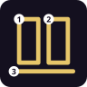 | **Schwebende Bastion** `sig_S04` | A · Defensiver Schwebe-Buff · 7 s | `self` | 36 | You lift a few pixels for 7 s behind two hovering armour floes: shots from the front break on them (each floe takes 4), frontal hits deal half damage. Flanks and back stay open; you glide slowly. | Türkisgraue Schollen wie Glassteinplatten mit vergoldeten Nietlinien; die rechte Seite bleibt geöffnet. | Seitlich/hinten verwundbar; Sperrfeuer kann Platten einzeln brechen. |
| S05 | 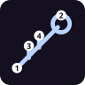 | **Kometenträger** `sig_S05` | A · Sprung-Manöver | `direction` | 30 | You leap high, fly a short diagonal comet arc dropping three shards, then dive onto the shown landing circle: three staggered cracks hit around it. | Dunkelblau mit blassen Saphirsplittern und kupferrotem Stoßkern; ellipsoidisches Himmelsbruchstück. | Angriff im Flug erkennbar, Zielkreis vor Impact; bewegliche Gegner können ausweichen. |
| S06 | 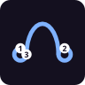 | **Luftnähte** `sig_S06` | A · Raumlinien-Manöver | `dual` | 28 | Set two air anchors: a taut seam spans between them. Crossing it gives a controlled push along the seam (enemies too), your projectiles bend along it. Tears after two crossings; anchors are breakable. | Bleiche Windfäden, scharf gebrochene Perlmutt-Nähte und kleine blaue Knoten. | Im PvP sichtbar und für den Gegner ebenfalls durchquerbar; Anker können zerstört werden. |
| S07 | 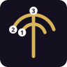 | **Nachhallarchiv** `sig_S07` | B · Kampfreaktor · 6 s | `self` | 32 | For 6 s your first two normal attacks are archived: each replays a moment later at the same spot as a brighter magic echo with half damage (no self-trigger). | Rauchsilber, Messingstaub und durchsichtige Viertelbogen-Fragmente, die den Avatar um einen Frame verzögert umschreiben. | Echos deutlich heller und geometrisch gestreckt; maximal zwei, kein Selbst-Trigger. |
| S08 |  | **Sekundenpfand** `sig_S08` | B · Delayed-Area | `ground` | 30 | An open seal records where enemies stand during 1.5 s; then narrow pillars strike exactly those recorded spots one after another — not where they are now. | Kupferblau und Schieferweiß, sechs gezackte Ziffernmarken auf einer gebrochenen Bodenplatte. | Sehr deutliches Bodenwarnzeichen, Ausweichraum zwischen Säulen; kein Echtzeit-Stop. |
| S09 |  | **Stillfuge** `sig_S09` | B · Stasis-Feld | `ground` | 36 | After 0.8 s a hexagonal dome closes for 4 s: projectiles inside crawl, enemies inside attack and move slowly. Afterwards your projectiles fly on, enemy ones dissolve. Bosses resist. | Mattweiß mit innen schwebenden schwarzkupfernen Glasflocken und segmentiertem Warnrand. | Keine globale Zeitstopp-Logik. Innerhalb klarer Reichweite kann man den Rand verlassen; Boss-Resistenz. |
| S10 | 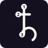 | **Rücksprungnadel** `sig_S10` | B · Positionanker · 5 s | `self` | 28 | A needle marks your position. Fight freely for 5 s; when it ends — or when you tap DEFENSE twice — you snap back to the needle (health, mana and timers stay as they are). Not while stunned or grabbed. | Grünliches Elfenbeinglas, vertikaler Dolch aus vier lichtgebrochenen Segmenten. | Anker für Gegner sichtbar und zerstörbar; Rücksprung bei Stun/Grab nicht frei verfügbar. |
| S11 | 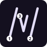 | **Spiegelversatz** `sig_S11` | B · Echoangriff | `aim` | 30 | Mark a spot beside you: a glassy afterimage of your stance stands there. Your next two melee hits are repeated from that spot a moment later (reduced damage). No health, no AI. | Violettgraue Glas-Afterimages und zwei schmale, schräg geneigte Spiegelkanten. | Echo verschwindet bei Verlust der LoS oder nach maximal zwei Treffern; selbst keine neuen Specials. |
| S12 |  | **Schicksalsnadel** `sig_S12` | B · Markierung und Finisher | `aim` | 32 | Thread a single enemy: your next hit pins a needle to it, the next two hits charge it, then a follow-up thrust runs along your last attack. If the enemy blocks, the needle falls off. | Drei asymmetrische Nadeln aus dunklem Roségold, dünne blaue Herzschlaglinien. | Blockt der Gegner den zweiten Treffer, verfällt die Nadel; sichtbares Entladefenster. |
| S13 | 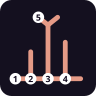 | **Splittergarten** `sig_S13` | C · Platzierte Objektfamilie | `ground` | 38 | Seven crack cores open and three crystal blossoms grow (max. three per player). Hitting a blossom sprays splinters in the direction of the hit; they can be destroyed and wither after 10 s. | Jadegrüner Kern, rauchiges Korallenglas und dunkel geriffelte Kristallblätter. | Klare Blütenhitbox, maximal drei Objekte pro Spieler, abgeschwächter Schaden durch Kettenreaktion. |
| S14 | 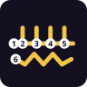 | **Seismischer Steg** `sig_S14` | C · Temporäre modulare Brücke | `placement` | 34 | Swipe a short line: four basalt plates rise as a walkway for 9 s. Allies move faster on it, enemies stumble the first time they cross. Heavy blows break single plates. It never blocks the lane. | Dunkle Basaltflächen mit gelben Bruchkernen und versetzten, metallischen Kanteneinsätzen. | Nie vollständige Lane-Versperrung. Angriffsflächen in der Höhe begrenzt, zerstörbar durch definierte Beam-Schadensklasse. |
| S15 |  | **Flutschiene** `sig_S15` | C · Bewegliches Elementarfeld | `placement` | 32 | Swipe a flow line: a water channel rolls along it for 7 s, pushing projectiles and light minions downstream and speeding you up when you run with the current. One per player. | Seidenblau, schmale platinfarbene Wellenleisten, bewegliche Kristallfische als innere Strömungsmarker. | Maximal eine Schiene pro Spieler; frei bleibende Seitenausweichwege; keine Schiebung von Bossen oder massiven Burgstrukturen. |
| S16 | 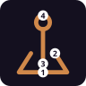 | **Glutpumpe** `sig_S16` | C · Umweltreaktor | `ground` | 34 | Ram in a pressure pump. Your fire (or lava under it) loads heat; water on a hot core blasts a steam roller sideways; the third trigger bursts it. Enemies can break it first. | Ziegelrot, kupferne Keilventile, poröser schwarzer Glasstein und heiße Lichtadern. | Gut lesbare Druckanzeige; Gegner kann die Pumpe gezielt zerstören, bevor die Reaktion startet. |
| S17 | 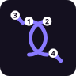 | **Raumfalter** `sig_S17` | C · Räumliche Ablenkzone | `dual` | 34 | Two points span a curved space fold: narrow projectiles of both sides glance off it at a fixed angle, beams lose part of their power. Collapses after four interactions. | Kühles Graugold und blauviolette Faltnähte, flache Segel aus zerbrochenen Spiegelresten. | Für alle sichtbar. Eine grüne/violette Ein- und Ausrichtungslinie zeigt Gefahrenkorridore. |
| S18 |  | **Glasfeld** `sig_S18` | C · Reaktive Spiegelboden-Zone | `ground` | 32 | The ground turns into a mirror mosaic for 8 s. Your impacts on it charge tiles; enemy projectiles over a charged tile throw a short reflected fragment beam back. Spent tiles go dark. | Weißblaue Kristallkrümel, schwarze Fugen, jadefarbene polierte Innenflächen. | Schmale Fläche, begrenzte Reflexionsladungen, sichtbare dunkle Plättchen für bereits verbrauchte Sektoren. |
| S19 | 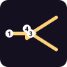 | **Strahlenweber** `sig_S19` | D · Beam-Umleitungssetup | `ground` | 40 | Place a three-armed prism. When one of YOUR beams hits it, the beam splits into two weaker, angled branches with shorter reach. Enemy beams wear it down; spent after 3 s of beam. | Rotgoldene Faseradern, kupferne Prismenarme und eine helle mittlere Lichtfuge. | Prisma vor dem Schuss sichtbar; leicht zerstörbar; Gesamt-DPS liegt unter ungeteilter Strahlstärke. |
| S20 |  | **Prismenhalter** `sig_S20` | D · Einmaliges Projektil-Umladen | `self` | 30 | Two V-clamps open in front of your hands: the next enemy projectile that hits you from the front is caught. Your next attack fires it back as a slower spinning crystal salvo (4 s window). | Gebrochener Opalkäfig in Bronze, cyanfarbene Resonanznähte und fliegende Staubscheiben. | Nur reflectable/capturable, kein Beam und keine Spezialrune als gespeichertes Objekt. |
| S21 | 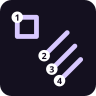 | **Schwarmprotokoll** `sig_S21` | D · Zielmarkierter Salvenmodus · 7 s | `self` | 34 | Four launch windows open for 7 s. Your first hit marks a priority target; every further hit launches one homing needle at it (max. four, 0.4 s apart). Walls break the lock. | Helle Fliedernadeln auf dunklen Schieferbahnen, feine versetzte Zahlenkerben an den Projektilkörpern. | Maximal vier Schüsse, mindestens 0,4 s Abstand; Zielwechsel muss aktiv getroffen werden. |
| S22 |  | **Rissweiche** `sig_S22` | D · Projektildurchgang | `dual` | 30 | Two portal edges for projectiles only: your shots entering edge A leave edge B in its direction; enemy shots glance off. Closes after three of your shots; breakable. | Ausgefranste Lapislazulikanten mit goldenem Innerand, wie zwei zerbrochene Torrahmen aus Splittern. | Gegner darf ausweichen oder Portale zerstören. LoS der Ausgangsmündung muss zulässig bleiben. |
| S23 |  | **Polarisationswerk** `sig_S23` | D · Temporärer Magnetturm | `ground` | 34 | A magnetic rotor tower bends light metallic projectiles (arrows, bolts) to the side you cast from; flames and void stay unaffected. Overloads after six deflections; breakable. | Kupferrot, türkis leuchtende Leitbahnen, schwebende gezahnte Rotoren und grobes Mica-Glitter. | Turm ist sichtbar und zerstörbar. Große schwere Angriffe dürfen ihn trotz Richtungsänderung durchbrechen. |
| S24 | 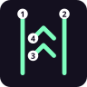 | **Schwerelosband** `sig_S24` | D · Vertikales Korridorfeld | `placement` | 30 | Swipe a narrow corridor: for 6 s enemies crossing it are lifted briefly (not held), your projectiles passing it fly longer. | Dunkelindigo mit mintgrünen Partikelmarken; feine gebogene Messinglinien zeigen das Kraftfeld. | Feld schmal, kurzer Trigger pro Gegner, Bodenanker deutlich. |
| S25 |  | **Klingenchor** `sig_S25` | E · Orbitale Waffenobjekte · 7 s | `self` | 36 | Three ornate splinter blades orbit you for 7 s. Melee hits charge them; your next heavy sends every charged blade at the target. Uncharged blades shield you from small projectiles (three blocks). | Dunkelrotes Nachtglas, cremefarbene Schneidkanten, schmale ornamentierte Kernspalten. | Maximal drei Klingen und begrenzter Blockwert; Gegner sieht volle geladene Klingen leuchten. |
| S26 | 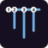 | **Marionettenfaden** `sig_S26` | E · Manipulation einer Einzelinstanz | `aim` | 30 | Light threads bind a crate, wall segment, small summon or minion near the aimed spot for 4 s: you drag it toward you and can bowl enemies over with it. Heroes only get a short push. Breaks when you are hit. | Kalter Graphit, kupferblaue Rissfäden, keine puppenartigen humanoiden Gegnerkörper. | Strenge Massengrenze und LoS; jederzeit durch Block bzw. Treffer unterbrechbar. |
| S27 |  | **Runenschmiede** `sig_S27` | E · Aktivierter Umgebungs-Forge | `self` | 36 | A floating forge grip marks your next own wall segment or a crate in reach (8 s): it becomes a tool — wall piece = break lance, bulwark = shield, crate = throwing block. Your next heavy uses it up. Fails visibly without an object. | Satinbronze mit smaragdgrüner Glut im Kern, runisch strukturierte Materialschichten. | Braucht echtes gültiges Objekt in Reichweite. Aktivierung scheitert transparent, wenn keine erlaubte Ressource vorhanden ist. |
| S28 |  | **Echofamulus** `sig_S28` | E · Kurzlebige Aktionsprojektion · 5 s | `self` | 30 | A flat projection plate with an eye mark follows your weapon hand for 5 s. After two successful actions it copies your last attack vector once as a weak thrust, then burns out. | Heller rauchiger Bernstein, grob gepixelte Leuchtfäden, keine menschliche Klonfigur. | Einmalige Auslösung und reduzierte Schadensskalierung. |
| S29 |  | **Bruchkoloss** `sig_S29` | E · Lokales Großkonstrukt | `ground` | 42 | Building plates rise into a shoulder: three arm segments and a huge fist. After a clear 0.7 s wind-up it punches horizontally, throws enemies back and smashes props. Enemy beams can break the fist. | Schiefergraue Blöcke, smaragdgrüne Fugen, polierte violette Energiegelenke. | 0,7 s gut sichtbarer Wind-up, Faust kann durch schweren gegnerischen Beam zerlegt werden. |
| S30 | 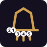 | **Jägerglocke** `sig_S30` | E · AI-Priorisierungs-Signal | `ground` | 28 | Throw a bell core: three ringing waves mark enemy summons for 8 s — your own beasts and golems hunt the marked ones first. The bell can be destroyed. | Dunkeltürkis, drei bronzene Schallzungen, feiner rissiger Schallfilm. | Markierung sichtbar; gegnerisches Team kann Klinge/Glockenkern zerstören oder das Ziel aus Reichweite führen. |
| S31 |  | **Runengericht** `sig_S31` | F · Temporäre Regelzone | `ground` | 36 | Four tablets frame a rule zone for 8 s: the first projectiles of each team that enter it are slowed and turned aside (two per team). Team-neutral; tablets are breakable. | Messingweiße Tafeln mit asymmetrischen Buchstaben, tiefblaue Lichtnaht; kein fertiger Anime-Domain-Dome. | Teamneutral und begrenzte Trigger pro Runde; Gegner darf das Feld meiden oder Tafeln zerstören. |
| S32 | 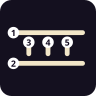 | **Exilkorridor** `sig_S32` | F · Spurförmige Kontrollzone | `placement` | 30 | Swipe a narrow corridor: for 6 s enemies entering it are hampered (much slower dodging) for under a second. Guarding or jumping frees them. | Nachtblauer geschwungener Feldrand, cremefarbene Fasertexturen und unterbrochene rote Warnschlitze. | Begrenzte Breite, Block oder Jump kann die Behinderung lösen. |
| S33 |  | **Erntezirkel** `sig_S33` | F · Einmaliger Reaktor nach Treffer-Events | `ground` | 34 | A seed seal opens under you: your hits within its reach charge up to three seeds. At three — or when it runs out — three ground lances burst at its rim and throw enemies back. | Moosgoldene Schraublinien mit schwarzen Saatkernen und kleinen warmen Messingkanten. | Maximal drei Ladungen, keine Trigger durch DoT-Ticks oder den eigenen Final-Effekt. |
| S34 | 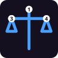 | **Scherbenhandel** `sig_S34` | F · Offensiv-defensiver Tausch | `self` | 30 | Scales appear over your weapon hand: your next projectile pauses for a heartbeat. GUARD in that moment melts it into a frontal shard shield; otherwise it flies normally. | Mattgoldene Waagschalen, blaues Kernfeuer und schwach rotierende Messingfugen. | Nur gewöhnliche Projectile-Events, nie Beam oder Sonderattacke; Entscheidung vor Flugstart. |
| S35 |  | **Resonanzkorridor** `sig_S35` | F · Schallgelenkte Arena-Kette | `placement` | 34 | Swipe a line: three resonance plates stand along it. Hitting a plate (melee, shockwave, projectile) sends a sound pulse to the next plate, damaging enemies between — up to three relays. | Elfenbeinsilberne Membranen, rote Resonanzadern, gebrochene halboffene Schallmuscheln. | Alle Platten sichtbar; Gegner kann sie zerstören oder die Kette unterbrechen. |
| S36 |  | **Weltnaht** `sig_S36` | F · Bewegliche Risslinie | `placement` | 36 | Swipe a curved line: a rift wave rolls along it. For 7 s each side acts once on everyone crossing: enemies are shoved through, projectiles are bent sideways, crates tip over. One per player. | Schwarzes vulkanisches Glas mit smaragdgrünem Kernlicht, doppelte gezackte Außennaht. | Gut sichtbarer Verlauf vor Auslösung, maximal eine Risslinie pro Spieler. |
| S37 |  | **Eiszacken** `sig_S37` | G · Objekt · Bodenkontrolle · 3 s | `direction` | 34 | A row of ice spikes bursts out of the ground ahead, one after another (like a frost mage's ice line): each spike hits, launches and freezes briefly; they stay as obstacles for 3 s and you can stand on them. | Klare, gezackte Eisspitzen mit weißen Kanten — ein eigenes Objekt, keine Säule. |  |
| S38 | 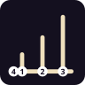 | **Schachtwuchs** `sig_S38` | G · Arena · Plattformen · 8 s | `ground` | 38 | Three stone shafts grow at the target point like steps (low, middle, high): a shaft rising under a foe hits and launches it, a Wizard standing on the spot is carried up. They stay 8 s as platforms. | Gestufte Steinschächte mit Wachstumsringen und goldenen Fugen. |  |
| S39 | 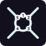 | **Tidenbohrer** `sig_S39` | G · Buff · Rotationspanzer · 6 s | `self` | 40 | A spinning shell of water closes around you for 6 s: it takes a third of every hit, and its four nozzles hammer water jets at nearby foes while it turns. Heavy attacks fire all four jets at once. | Eine rotierende Wasserhülle mit vier Düsen — der Körper selbst wird zum Angriffsmodul. |  |
| S40 | 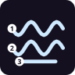 | **Wasseratmung** `sig_S40` | G · Atemtechnik · Kampfstil · 15 s | `self` | 32 | Water breathing for 15 s: every melee swing draws a flowing water arc, combo finishers send a water wave forward and charged attacks cut a wave across the lane. | Fließende Wasserbögen mit Gischtkanten folgen jeder Klinge. |  |
| S41 | 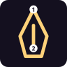 | **Flammenatmung** `sig_S41` | G · Atemtechnik · Kampfstil · 15 s | `self` | 34 | Flame breathing for 15 s: every melee swing leaves a fire arc, hits burn, combo finishers end in a rising flame wheel and charged attacks breathe a burst of fire. | Lodernde Feuerbögen und Glut folgen jeder Klinge. |  |
| S42 |  | **Donneratmung** `sig_S42` | G · Atemtechnik · Kampfstil · 15 s | `self` | 34 | Thunder breathing for 15 s: swings flash as lightning lines, the sprint attack becomes a lightning dash through everyone in line, and charged attacks drop a thunderbolt on the nearest foe. | Gelbe Zickzack-Blitze und Funken folgen jeder Bewegung. |  |
| S43 | 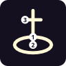 | **Sanktuarium** `sig_S43` | G · Objekt · Heilzone · 10 s | `ground` | 36 | A sanctuary obelisk rises at the target point inside a magic circle: allies standing in the circle heal and shake off slows for 10 s. Foes can smash the obelisk. | Ein heller Obelisk mit grünem Kristall über einem rotierenden Runenkreis. |  |
| S44 | 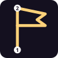 | **Kriegsbanner** `sig_S44` | G · Objekt · Buffzone · 10 s | `ground` | 32 | A war banner is planted at the target point: allies near it strike harder (+20 % melee damage) and move faster for 10 s. Foes can tear the banner down. | Ein rotes Banner mit goldenem Saum an einem Speerschaft, das im Wind flattert. |  |
| S45 |  | **Blitzmarke** `sig_S45` | G · Zweistufig · Teleport · 5 s | `direction` | 30 | Stage 1: throw a marked kunai — it sticks in the first foe it hits, otherwise in the ground. Stage 2 (tap the slot again within 5 s): teleport to the mark; in a foe you appear behind it and strike. | Dunkler Kunai mit Ring und flatterndem gelbem Siegel-Zettel; Teleport mit Nachbild und Lichtblitz. |  |
| S46 |  | **Spiralkugel** `sig_S46` | G · Zweistufig · Launcher · 3 s | `direction` | 38 | Stage 1: rush forward with a spinning energy ball — the impact launches the foe high. Stage 2 (tap again within 2.5 s): teleport above it and slam it into the ground with an explosion. | Eine wirbelnde blaue Energiekugel mit weißen Spiralbahnen in der Hand. |  |
| S47 |  | **Bannfalle** `sig_S47` | G · Zweistufig · Falle · 20 s | `ground` | 28 | Stage 1: lay a seal trap at the target point — it is always armed and goes off when a foe steps on it. Stage 2 (tap again within 6 s): detonate it yourself with a bigger blast. After the window it stays armed but can only be set off by contact. | Ein Papiersiegel mit rotem Zeichen in einem doppelten Bannkreis. |  |
| S48 |  | **Schattenkonter** `sig_S48` | G · Haltung · Konter-Ladungen · 12 s | `self` | 34 | Three counter charges for 12 s: each hit you take is negated — you vanish and reappear behind the attacker with a counter strike (without a known attacker: a sidestep). | Drei dunkle Schattenkugeln kreisen um den Körper; beim Konter bleibt ein Schattenschleier zurück. |  |

Hinweis: `DRAGON INVOCATION` hat zwei Rezepte (Bestia+Ignis+Ventus und Fulgur+Ignis+Terra). Von den 220 möglichen Drei-Runen-Kombinationen der Basisrunen (mit Wiederholung) sind nur wenige belegt.

## 5. Transformationen & Form-Techniken

Transformationen geben kein zusätzliches Rune-Deck; ihre Techniken liegen auf **Heavy-Charge + Richtung** (kurz = antippen/kurz laden, voll = 1,2 s laden). Fokus-Transformation verbraucht die Focus-Leiste (1,5/s, Unity-Wert).

| Form | Quelle | Forward kurz / voll | Up kurz / voll | Down kurz / voll | Sprint + Angriff |
|---|---|---|---|---|---|
| **B01 Risswild** (drei gebrochene Schmelzbänder, Splitterkrone; ehem. Ninefold) | Arcane-State-Rune `buff_B01` (⧗, max. 1 pro Deck, 16 s) | Rissimpuls / Verdichteter Risskern | Bruchheber / Doppelter Rissaufstieg | Scherfeger / Rissfeld-Einschlag | Beast Pounce |
| **B02 Arkengestell** (offenes Kristall-Kraftgestell mit Halo und Bogen; ehem. Eidolon) | Arcane-State-Rune `buff_B02` (⧗, max. 1 pro Deck, 16 s) | Glyphenbolzen / Belagerungspfeil (Bogen) | Trägerheber / Lichtspalter | Ankerstampfer / Gericht des Gestells | Kolossstoß |
| **T01–T40** (40 weitere Arcane States, siehe 3.7) | je eine Arcane-State-Rune `buff_Txx` | aus dem Atlas | aus dem Atlas | aus dem Atlas | aus dem Atlas |
| **Focus Ascendant** | Focus 100 % → T / Tippen auf den Wizard (ohne Primal) | Radiant Wave / Annihilation Beam | Ascending Strike / Heaven Pillar | Light Nova / Starfall Crash | Radiant Lunge (goldener Durchstoß) |
| **Primal Bond** (Wolf / Schildkröte) | Focus 100 % → T mit Primal in der Nähe | — (Buff-Form: Tempo bzw. Panzerung) | — | — | Primal Pounce / Shell Rush |

Ehemalige Transformations-Spells: ANNIHILATION BEAM (über Focus Ascendant Forward voll); VOID IMPLOSION = Bestia+Terra+Void, INFERNO RAMPAGE = Bestia+Ignis+Void (normale Kombinationen).

## 6. Glossar: Delivery, Zielmodi, Tags

**Delivery-Klassen** (mechanische Klasse, unabhängig vom Look — jede Klasse hat einen gemeinsamen Controller):

| Delivery | Spells |
|---|---|
| `projectile` | IGNIS FIREBALL, VOID BOLT |
| `salvo` | — (noch ungenutzt) |
| `homing` | SOUL SEEKERS |
| `beam` | ANNIHILATION BEAM, INFERNO BEAM, GLACIAL RAY, THUNDER LANCE, NULL RAY, RADIANT LANCE |
| `cone` | DRAGON BREATH, POLLENSTURM |
| `burrow` | BURROW STRIKE |
| `area` | GALE SHOCKWAVE, ARC LIGHTNING, STONE SPIKES, FROST NOVA, HALO PULSE, AURA SHOCK, DORNENWUCHS, FLAMMENSAMEN, DRAGON INVOCATION, APOCALYPTIC HEAVENSURGE |
| `zone` | VOID IMPLOSION, FIRESTORM VORTEX, MAGMA FISSURE, BLIZZARD SURGE, FROST MIRROR GATE, HEILQUELLE, GIFTSUMPF, WELTENBAUM, STERNENANKER, LUFTNÄHTE, SEKUNDENPFAND, STILLFUGE, SPLITTERGARTEN, SEISMISCHER STEG, FLUTSCHIENE, GLUTPUMPE, RAUMFALTER, GLASFELD, STRAHLENWEBER, RISSWEICHE, POLARISATIONSWERK, SCHWERELOSBAND, BRUCHKOLOSS, JÄGERGLOCKE, RUNENGERICHT, EXILKORRIDOR, ERNTEZIRKEL, RESONANZKORRIDOR, WELTNAHT, SCHACHTWUCHS, SANKTUARIUM, KRIEGSBANNER, BANNFALLE |
| `wall` | CONSTRUCT BULWARK, STONE WALL |
| `telekinesis` | GRAVITY LIFT |
| `capture` | MIRROR WARD, SPIEGELVERSATZ, SCHICKSALSNADEL, MARIONETTENFADEN |
| `slam` | SEISMIC SLAM |
| `stomp` | TITAN STOMP, SHADOW STOMPER |
| `summon` | BEAST FAMILIAR, SHADOW DOPPELGANGER, REVENANT CALL, STORM WOLF, VOID SPIDER, RUNE GOLEM, WORLD RUNE SERPENT, SPIRIT WOLF, SIEGE GOLEM |
| `dash` | SHADOW STEP, INFERNO RAMPAGE, TEMPEST BLITZ, KOMETENTRÄGER, EISZACKEN, BLITZMARKE, SPIRALKUGEL |
| `heavy_object` | METEOR CATACLYSM |
| `self` | SANDSTORM BASTION, ARCANE AEGIS, SOLAR ORB, LUNAR ORB, ECLIPSE, THUNDERHEAD, BLOOD MOON, STARFALL, AURORA VEIL, HEILBLÜTE, GROSSE BLÜTE, SEGENSKREIS, FLAMMENKLINGE, FROSTKLINGE, STURMKLINGE, GIFTKLINGE, BLUTKLINGE, REISSKLINGE, ARKENGESTELL, RISSWILD, RISSWILD, ARKENGESTELL, SCHLACKENKERN, KORALLENSCHILD, BRUCHFLUG, IONSPINDEL, OSSUARIUM, FADENSCHLAG, NULLFELDTRÄGER, FADENREGENT, KÄLTESTILLSTAND, SÄUREGERÜST, ASTERGLIED, VORAUSSCHNITT, SONNENWYRM, GÖTTLICHER RIESE, MYSTISCHER AFFE, HIMMELSREGENT, AUREOLENSCHWARM, SCHWEBENDE BASTION, NACHHALLARCHIV, RÜCKSPRUNGNADEL, PRISMENHALTER, SCHWARMPROTOKOLL, KLINGENCHOR, RUNENSCHMIEDE, ECHOFAMULUS, SCHERBENHANDEL, TIDENBOHRER, WASSERATMUNG, FLAMMENATMUNG, DONNERATMUNG, SCHATTENKONTER |

**Zielmodi** (gleiche Regeln für Touch, Maus/Tastatur, Gamepad):

| Modus | Bedienung |
|---|---|
| `direction` | Tap its slot (Z/X/C): it fires the way you face. Mouse: toward the cursor. Touch: drag the slot onto the field to aim. |
| `ground` | Tap its slot, then tap the spot where it should land (mouse: click; gamepad: right stick + A). Esc / B cancels. |
| `placement` | Tap its slot, then swipe a line on the ground — the wall is built exactly along it, in any direction. Cleaner runes give more blocks. |
| `ally` | Tap its slot, then tap the ally to protect (yourself, a minion or a summon). |
| `aim` | Tap its slot, then drag / point the direction (depth included). The cone shows the enemy it will catch; release to cast. |
| `dual` | Tap its slot, then set the first point and the second point. |
| `self` | Tap its slot: it takes effect around you at once. |

**Interaktions-Tags:** `reflectable` (Parry/Spiegel wirft zurück), `capturable` (Mirror Ward fängt), `blockable` (Block reduziert), `clashable` (Beam Clash: zwei Beams treffen sich Spitze an Spitze, Mashen entscheidet), `beamDamageable` (kann von Beams zerstört werden, z. B. Meteor).

**Weitere Systeme, mit denen Spells interagieren:** Bodeneffekte (Eis, Feuer, Lava, Pfützen, Krater — Umgebungsschicht), Himmelsfelder verstärken/schwächen ganze Elemente (Sonne: Feuer/Licht +, Eis/Schatten −; Mond: Wasser/Eis/Schatten +, Feuer −; Eclipse; Thunderhead; Blood Moon; Starfall; Aurora), Schatten (Shadow Stomper hält Schatten fest), Steinwände (Kollision für alle), Gräber/Seelen (Revenant Call), Mounts (reitbare Beschwörungen).

## 7. Statistik

- Runen: 81 (davon 10 Basis, 2 Solo-Spezial, 48 Signature-Spezial, 17 Arcane States, 3 Transformation)
- Spells: 135 — Fundamental 11, Solo 2, Compound 39, Himmelsfelder 7, Advanced 10, Transformation 1
- Rezepte: 134 · freie Zwei-Runen-Paare: 17 von 55

## 8. Hinweise für den Research-Agenten

**Kontext:** GRIMGE ist ein 2,5D-Fantasy-Brawler (Little-Fighter-artige Tiefe, Lane-/Burgen-Modus „Castle Siege“, Training, Arena, Dungeon). Spells entstehen durch gezeichnete Runen + Fusion. Es gibt Nahkampf, Transformationen, Primals (Begleiter) und Waffen.

**Regeln für neue Spells:**
- Eigene, originale Namen und Looks (keine geschützten Namen aus anderen Spielen/Animes übernehmen; Inspiration ja, Kopie nein).
- Jede Idee einer **bestehenden Delivery-Klasse** zuordnen (oder begründet eine neue vorschlagen) und einen **Zielmodus** wählen.
- Ein **Rezept** angeben — bevorzugt eines der freien Paare aus Abschnitt 4 bzw. eine freie Drei-Runen-Kombination; Element-Logik der Runen respektieren (Ignis Feuer, Ventus Wind, Fulgur Blitz, Terra Erde, Aqua Frost/Wasser, Bestia Tier, Konstrukt Bau/Mechanik, Void Leere/Gravitation, Lux Licht, Umbra Schatten).
- Interaktionen nennen: Tags, Wechselwirkung mit Bodeneffekten, Himmelsfeldern, Beam Clash, Wänden, Mounts.
- 2,5D bedenken: Lane-Tiefe (z), Höhe (Launcher, Luftziele), Reichweiten in px (Bühne 1024 × 576, Held ≈ 88 px hoch).
- Visualisierung beschreiben (Formen, Farben, Bewegung, Partikel) — im Stil der Spalte „Visualisierung“.

**Vorlage pro Vorschlag:**
```
Name:            (original)
Rezept:          RUNE + RUNE (+ RUNE)        # bevorzugt freies Paar
Tier / Mana:     2 / Summe der Runen
Delivery:        projectile | salvo | homing | beam | cone | burrow | area | zone | wall | telekinesis | capture | slam | stomp | summon | dash | heavy_object | self
Zielmodus:       direction | ground | placement | ally | aim | dual | self
Tags:            reflectable, capturable, blockable, clashable, beamDamageable
Wirkung:         (Mechanik, Zahlen grob: Schaden, Radius, Dauer)
Visualisierung:  (was man sieht)
Interaktionen:   (Boden, Himmel, Clash, Wände, Elemente)
Inspiration:     (Spiel/Anime + was übernommen wird — nur als Idee)
```
